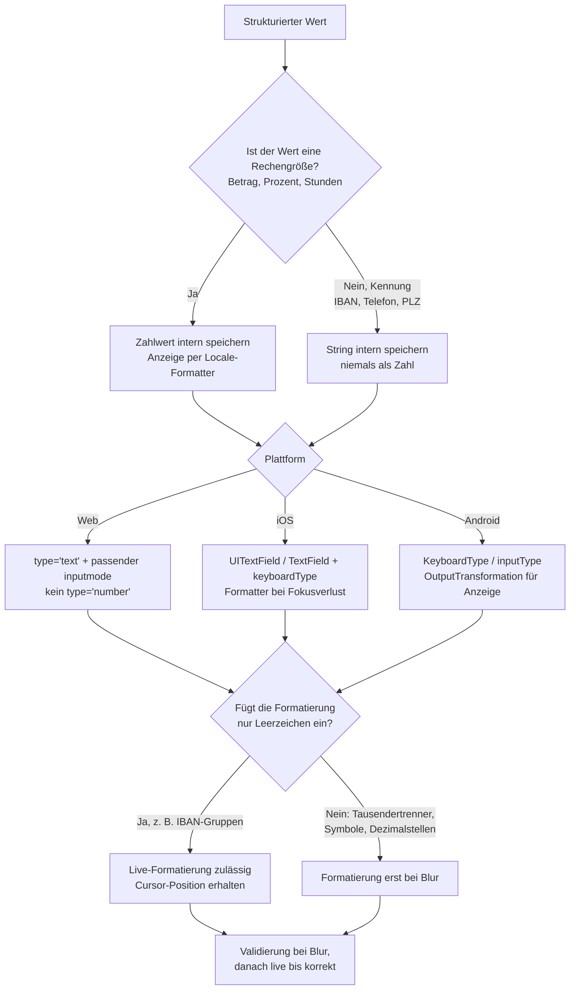

---
meta:
  title: Input-Formatierung – Plattformen und Eingabetypen
  description: Plattformspezifische Grundsätze (Web, iOS, Android) und eingabespezifische Regeln für die (Auto-)Formatierung von Währungsbeträgen, IBAN, Prozent, Stunden, Telefonnummern und Postleitzahlen
relatedTopics: ["patterns/input-formatting", "patterns/form-layout"]
layout: common
---

## Verwendung

Formatierte Eingabefelder machen strukturierte Werte lesbar und prüfbar: `1.234,50 €` ist schneller erfassbar als `1234.5`, `DE89 3704 0044 0532 0130 00` leichter abzugleichen als eine 22-stellige Zeichenkette. Gleichzeitig ist Formatierung eine der häufigsten Fehlerquellen in Formularen: springende Cursor, abgeschnittene Paste-Inhalte, falsche Dezimaltrenner auf mobilen Tastaturen und verwirrende Screenreader-Ansagen.

Leitsätze über alle Plattformen hinweg:

- **Formatierung ist Darstellung, nicht Daten.** Der gespeicherte Wert (`value`) ist immer normalisiert und locale-unabhängig.
- **Großzügig annehmen, einheitlich anzeigen.** Jede plausible Schreibweise wird akzeptiert, angezeigt wird das kanonische Format.
- **Formatieren beim Verlassen des Felds.** Live-Formatierung nur dort, wo ausschließlich Trennzeichen eingefügt werden und die Cursor-Position stabil bleibt.
- **Keine Input-Masken mit Platzhalterzeichen.** Masken irritieren Screenreader, blockieren Textersetzung und lassen leere Felder ausgefüllt wirken ([Adam Silver](https://adamsilver.io/blog/the-problem-with-input-masks-and-what-to-do-instead/)).

### Abgrenzung

- Datum und Uhrzeit (eigene Patterns mit Picker-Logik)
- Mengenangaben mit Stepper (Number Field mit Plus/Minus) – nur am Rande behandelt
- Passwörter, PINs, Einmalcodes

---

## Decision Flow



---

## Plattformübergreifende Grundbegriffe

| Begriff | Bedeutung | Beispiel Währungsbetrag |
|---|---|---|
| **Eingabetext** | Was gerade im Feld steht, inkl. Tippfehlern | `1234,5` |
| **Anzeigewert** | Formatierte Darstellung nach Blur | `1.234,50 €` |
| **Wert (`value`)** | Normalisierter, locale-unabhängiger Datenwert | `1234.50` (Dezimal-String) oder `123450` (Cent) |
| **Locale** | Sprache + Region, bestimmt Trennzeichen und Symbolposition | `de-DE`, `de-CH`, `en-US` |

### Parsing, Formatierung und Validierung

Drei getrennte Schritte mit jeweils eigener Aufgabe. Werden sie vermischt, entstehen typische Fehler: Formatter, die Eingaben ablehnen, oder Prüfregeln, die auf dem Anzeigetext statt auf dem Wert arbeiten.

| Schritt | Richtung | Leitfrage | Bei Erfolg | Bei Misserfolg | Beispiel Währungsbetrag |
|---|---|---|---|---|---|
| **Parsing** | Eingabetext → Wert | Lässt sich der Text als Wert dieses Typs lesen? | Normalisierter `value` | Parse-Fehler, Text bleibt stehen | `1.234,5 €` → `1234.50` |
| **Formatierung** | Wert → Anzeigewert | Wie wird der Wert in dieser Locale dargestellt? | Kanonischer Anzeigewert | Kann nicht scheitern, da nur geparste Werte formatiert werden | `1234.50` → `1.234,50 €` |
| **Validierung** | Wert → gültig / ungültig | Erfüllt der Wert die fachlichen Regeln? | Keine Meldung | Validierungsfehler, Wert und Anzeige bleiben erhalten | `1234.50` > Maximum `1000` → „Höchstens 1.000,00 €“ |

- **Reihenfolge**: Parsen → Formatieren → Validieren. Auch ein parsebarer, aber ungültiger Wert wird formatiert, damit Feld und Fehlermeldung dieselbe lesbare Darstellung zeigen.
- Der Parser akzeptiert jede plausible Schreibweise, der Formatter erzeugt **genau eine** kanonische Darstellung pro Locale. Jede formatierte Ausgabe ist wieder parsebar.
- Validierung prüft den **Wert**, nie den Anzeigetext. Keine Regex auf `1.234,50 €`, sondern Vergleich von `1234.50` mit Minimum und Maximum.
- Ist der Eingabetext nicht parsebar, bleibt er unverändert stehen und es erscheint eine Fehlermeldung. Kein stilles Löschen oder Zurücksetzen.
- Ein leeres Feld ist parsebar (`value` = leer). Ob leer zulässig ist, entscheidet die Validierung (Pflichtfeld).

**Zwei Fehlerarten mit unterschiedlichen Meldungen**

| Fehlerart | Ursache | Beispielmeldung |
|---|---|---|
| Parse-Fehler | Text ergibt keinen Wert des Typs | „Betrag enthält ungültige Zeichen. Erlaubt sind Ziffern, Komma und Punkt.“ |
| Validierungsfehler | Wert verletzt eine fachliche Regel (Bereich, Länge, Prüfziffer, Pflicht) | „Betrag darf höchstens 1.000,00 € betragen.“ |

**Beispiel IBAN**

- Parsing: Leerzeichen und Bindestriche entfernen, in Großbuchstaben umwandeln → `DE89370400440532013000`
- Formatierung: Vierergruppen → `DE89 3704 0044 0532 0130 00`
- Validierung: Länderkennung bekannt, Länge passend zum Land (DE: 22 Zeichen), Prüfsumme nach ISO 13616 (Modulo 97)

---

## Plattform: Web

### Wann wird formatiert?

| Event | Verhalten |
|---|---|
| `input` / `onChange` | Kein Umformatieren. Nur Zeichen filtern, die nie gültig sein können, und dann mit sichtbarem Hinweis statt stillem Verwerfen. Ausnahme: reine Gruppierung durch Leerzeichen (IBAN), wenn die Cursor-Position korrekt nachgeführt wird |
| `focus` | Anzeigewert **nicht** verändern. Ein Wechsel des Feldinhalts beim Fokussieren irritiert Screenreader- und Lupen-Nutzende. Der Parser akzeptiert formatierte Werte ohnehin |
| `paste` | Nicht blockieren. Inhalt übernehmen, normalisieren erst bei Blur oder sofort, wenn nur Trennzeichen entfernt werden |
| `blur` / `change` | Parsen → bei Erfolg kanonisch formatieren und `value` setzen → validieren |
| Submit | Erneut parsen und validieren (Autofill und Skripte lösen nicht immer `blur` aus) |

Validierungsrhythmus: erste Fehlermeldung bei Blur, danach live bei jeder Eingabe, bis der Fehler behoben ist.

### Wert und Darstellung trennen

- Formular-Komponenten halten zwei Zustände: `inputText` (String im Feld) und `value` (normalisierter Wert, z. B. `number`, Dezimal-String oder IBAN ohne Leerzeichen).
- Bei klassischen Formularen ohne JavaScript-Serialisierung: zusätzliches `<input type="hidden">` mit dem Rohwert oder serverseitiges Parsen mit demselben toleranten Parser.
- Für Beträge Gleitkommazahlen vermeiden: Cent als Integer oder Dezimal-String übertragen.
- Formatierung immer über `Intl.NumberFormat` (CLDR-Daten), nicht über selbst gebaute Regex-Ersetzungen.
- Parsing über die Trennzeichen der Locale: `Intl.NumberFormat(locale).formatToParts(1111.1)` liefert `group` und `decimal`. React Aria nutzt genau diesen Weg und erkennt zusätzlich fremde Ziffernsysteme ([React Aria](https://react-aria.adobe.com/blog/how-we-internationalized-our-numberfield)).

### Welche Input-Typen werden formatiert?

| HTML-Typ | Formatieren? | Begründung |
|---|---|---|
| `type="text"` (+ `inputmode`) | **Ja** – Standard für alle formatierten Felder | Volle Kontrolle über Anzeige, Parsing, Cursor |
| `type="tel"` | **Ja, zurückhaltend** | Keine Browser-Validierung, liefert Telefontastatur; Inhalt ist frei |
| `type="number"` | **Nein** | Anzeige und Dezimaltrenner steuert der Browser abhängig von Browser- bzw. Systemlocale, nicht von der App. `value` ist bei ungültiger Eingabe leer (`""`), Tausendertrenner sind unmöglich, Scrollrad und Pfeiltasten verändern Werte, führende Nullen gehen verloren ([GOV.UK](https://technology.blog.gov.uk/2020/02/24/why-the-gov-uk-design-system-team-changed-the-input-type-for-numbers/)) |
| `type="date"`, `type="time"` | **Nein** | Browser formatiert nach Systemlocale, `value` ist ISO |
| `type="email"`, `type="url"` | **Nein** | Kein Formatierungsbedarf |

Konsequenz: Ein „numerisches“ Feld mit Formatierung ist immer `type="text"` mit `inputmode="decimal"` oder `inputmode="numeric"`. `inputmode` ist nur ein Hinweis an die Tastatur und schränkt die Eingabe nicht ein – Hardware-Tastaturen und Paste liefern beliebige Zeichen.

### `maxlength` und Formatierung

- `maxlength` zählt auch Leerzeichen und Trenner. Ein gruppiert eingefügter Wert (`DE89 3704 0044 0532 0130 00` = 27 Zeichen) wird bei `maxlength="22"` **still abgeschnitten**.
- Daher: kein `maxlength` auf formatierten Feldern; Länge bei Blur prüfen und als Fehlermeldung ausgeben.

---

## Plattform: iOS

### Wann wird formatiert?

- **SwiftUI** `TextField(value:format:)` mit `FormatStyle`: Der gebundene Wert wird nur aktualisiert, wenn der Text parsebar ist. Die Neuformatierung des Texts erfolgt beim Absenden (Return) oder bei Fokusverlust – entspricht dem Blur-Prinzip ([Apple](https://developer.apple.com/documentation/swiftui/textfield/init(_:value:format:prompt:)), [fatbobman](https://fatbobman.com/en/posts/textfield-1/)).
- Bekannte Falle: Bei `.currency(code:)` steht das Symbol im editierbaren Text (`US$0.00`); Eingaben, die der Formatter nicht parsen kann, werden ignoriert ([Apple Developer Forums](https://developer.apple.com/forums/thread/757272)). Empfehlung: Währungssymbol außerhalb des Felds platzieren, im Feld nur `.number.precision(.fractionLength(2))`.
- **Live-Formatierung** (z. B. IBAN-Gruppen) über `UITextFieldDelegate.textField(_:shouldChangeCharactersIn:replacementString:)` mit eigener Cursor-Berechnung; in SwiftUI nur mit Workarounds (`onChange` mit Text-Neusetzung, Cursor springt ans Ende).
- `onSubmit` und `@FocusState` als Hook für „Blur“.

### Wert und Darstellung

- Gebundener Wert ist typisiert (`Decimal`, `Double?`, `String`), der Feldtext ist Darstellung.
- Für Beträge `Decimal` statt `Double` verwenden.
- Formatter: `FormatStyle` (`.number`, `.percent`, `.currency(code:)`, `Measurement.FormatStyle`) bzw. `NumberFormatter` mit `locale = .current` oder App-Locale.

### Tastaturen (`keyboardType`)

| `keyboardType` | Inhalt | Einsatz | Hinweis |
|---|---|---|---|
| `.numberPad` | 0–9 | PLZ (DE/AT/CH), Ziffern-Kennungen | Kein Dezimaltrenner, kein Minus, **keine Return-Taste** → Toolbar mit „Fertig“ ergänzen |
| `.decimalPad` | 0–9 + Dezimaltrenner | Beträge, Prozent, Dezimalstunden | Trennzeichen folgt Region bzw. aktiver Tastatur, nicht der App-Locale; kein Minus |
| `.phonePad` | 0–9, `+`, `*`, `#` | Telefonnummern | Keine Return-Taste |
| `.numbersAndPunctuation` | Ziffern + Satzzeichen inkl. `-`, `:` | Negative Beträge, Stunden `7:30` | Volle Tastatur auf Ziffernebene |
| `.asciiCapableNumberPad` | nur ASCII-Ziffern | Kennungen, wenn keine arabisch-indischen Ziffern entstehen sollen | ab iOS 10 |
| `.asciiCapable` / `.default` | Volltastatur | IBAN, alphanumerische PLZ | mit `.textInputAutocapitalization(.characters)` |

Ergänzend `textContentType` für AutoFill: `.telephoneNumber`, `.postalCode`, `.creditCardNumber` (es gibt keinen Content-Type für IBAN). `textContentType` bestimmt **nicht** die Tastatur – `keyboardType` immer explizit setzen.

### Web-Inhalte auf iOS (Safari, WKWebView)

| `inputmode` | Tastatur auf iOS |
|---|---|
| `numeric` | Ziffernblock 0–9, ohne Trenner und Minus |
| `decimal` | Ziffernblock + Dezimaltrenner gemäß iOS-Region bzw. Tastatur, **nicht** gemäß `<html lang>` |
| `tel` | Telefon-Ziffernblock mit `+ * #` |
| `text` | Volltastatur (einzige Variante mit Minus) |

Bekannte Abweichungen: Region mit Komma, aber Tastatur mit Punkt ([WebKit Bug 247242](https://bugs.webkit.org/show_bug.cgi?id=247242)); Regressionsberichte zu iOS 26.2 mit deutscher Sprache ([Apple Developer Forums](https://developer.apple.com/forums/thread/818268)). Folgerung: Parser akzeptiert immer `,` **und** `.` als Dezimaltrenner, wenn nur ein Trennzeichen vorkommt.

---

## Plattform: Android

### Wann wird formatiert?

- **Jetpack Compose (`TextFieldState`)**: `OutputTransformation` verändert nur die Darstellung, der State bleibt roh; das Framework verhindert, dass der Cursor zwischen eingefügten Trennzeichen landet. `InputTransformation` filtert oder normalisiert Eingaben (z. B. nur Ziffern, Großschreibung) ([Android Developers](https://developer.android.com/reference/kotlin/androidx/compose/foundation/text/input/OutputTransformation)).
- **Compose (älteres API)**: `VisualTransformation` mit `OffsetMapping`; falsches Offset-Mapping führt zu Abstürzen oder springenden Cursorn.
- **Views**: `TextWatcher`; für Telefonnummern existiert `PhoneNumberFormattingTextWatcher` (Live-Formatierung nach Geräteregion).
- Live-Gruppierung über `OutputTransformation` ist auf Android vergleichsweise robust, weil Wert und Darstellung technisch getrennt sind. Tausendertrenner und Dezimalstellen trotzdem erst bei Fokusverlust (`onFocusChanged`) ergänzen.

### Wert und Darstellung

- Compose: `TextFieldState.text` = Rohwert, `OutputTransformation` = Anzeige. Damit ist die Trennung im Framework angelegt.
- Accessibility-Hinweis: TalkBack liest den angezeigten (transformierten) Text vor – das ist für Gruppierungen erwünscht, muss aber mit echten Geräten geprüft werden.
- Formatter: `android.icu.text.NumberFormat` / `DecimalFormat` mit `Locale`, `android.icu.text.MeasureFormat` für Einheiten.

### Tastaturen

| Compose `KeyboardType` | View `inputType` | Einsatz | Hinweis |
|---|---|---|---|
| `Number` | `number` | PLZ, Ziffern-Kennungen | Gboard zeigt Ziffernblock mit Zusatzzeichen |
| `Decimal` | `numberDecimal` | Beträge, Prozent, Dezimalstunden | Dezimaltrenner je nach Tastatur-App und Version; Samsung- und Gboard-Tastaturen fügen bei `de-DE` teils `.` statt `,` ein ([Kotlin Slack](https://slack-chats.kotlinlang.org/t/2688201/hey-guys-i-need-help-i-released-my-new-app-one-week-ago-a-fe)) |
| – | `numberSigned` / `numberSigned\|numberDecimal` | negative Beträge | |
| `Phone` | `phone` | Telefonnummern | enthält `+ * # ( ) -` |
| `Text` + `KeyboardCapitalization.Characters`, `autoCorrectEnabled = false` | `textCapCharacters\|textNoSuggestions` | IBAN, alphanumerische PLZ | |

- `KeyboardOptions` sind nur Hinweise; Tastatur-Apps von Drittanbietern können sie ignorieren ([Android Developers](https://developer.android.com/reference/kotlin/androidx/compose/foundation/text/KeyboardOptions)).
- In Views ab API 26 `DigitsKeyListener.getInstance(locale, signed, decimal)` für locale-korrekte Dezimaltrenner; bekannte Lücken bei Fullscreen-Eingabe und arabischen Trennzeichen ([Android Developers](https://developer.android.com/reference/android/text/method/DigitsKeyListener), [Titanium JIRA](https://jira-archive.titaniumsdk.com/TIMOB-27616)).
- Autofill: Compose `ContentType` über `semantics` (z. B. Telefonnummer, Postleitzahl) ([Android Developers](https://developer.android.com/develop/ui/compose/text/autofill)).

### Web-Inhalte auf Android (Chrome, WebView)

- `inputmode="numeric"` und `"decimal"` öffnen den Ziffernblock der Tastatur-App; laut React Aria enthält Androids `numeric` Minus und Dezimaltrenner, `decimal` dagegen kein Minus ([React Aria](https://react-aria.adobe.com/blog/how-we-internationalized-our-numberfield)).
- Welches Trennzeichen erscheint, hängt von Tastatur-App und Systemsprache ab → Parser akzeptiert beide.

---

## Plattformvergleich auf einen Blick

| Aspekt | Web | iOS | Android |
|---|---|---|---|
| Zeitpunkt Formatierung | `blur` | Submit / Fokusverlust (`FormatStyle`) | `onFocusChanged`; Gruppierung live via `OutputTransformation` |
| Trennung Wert / Anzeige | eigener State oder Hidden Input | Binding (`Decimal`) vs. Feldtext | `TextFieldState` vs. `OutputTransformation` |
| Formatter | `Intl.NumberFormat` | `FormatStyle`, `NumberFormatter` | ICU `NumberFormat`, `MeasureFormat` |
| Feldtyp für Formatierung | `type="text"` + `inputmode` | `TextField` + `keyboardType` | `TextField` + `KeyboardType` |
| Nicht formatieren | `type="number"`, `date`, `time` | – (kein natives Number-Feld) | – |
| Dezimaltrenner-Quelle | Tastatur des OS, nicht `lang` | Region / aktive Tastatur | Tastatur-App + Systemsprache |

---

## Eingabespezifische Vorgaben

Jeder Eingabetyp gliedert sich in:

- **Plattformübergreifend**: Darstellung, Formatierungsregeln mit Beispielen, Normalisierung bei Copy/Paste, Verhalten bei Sprachwechsel
- **Web**, **iOS**, **Android**: Feldkonfiguration und Tastatur, Zeitpunkt und API der Formatierung, Wert und Anzeige, Copy/Paste, Locale-Quelle, Barrierefreiheit

Locale-Quelle je Plattform (gilt für alle Eingabetypen):

| Plattform | Locale für Formatierung | Besonderheit |
|---|---|---|
| Web | App-Einstellung bzw. `<html lang>`, ersatzweise `navigator.languages` | Tastatur-Dezimaltrenner folgt dem Betriebssystem, nicht `lang` |
| iOS | `Locale.current` bzw. SwiftUI-Environment `\.locale` | App-Sprache pro App wählbar; Zahlenformat seit iOS 16 in den Einstellungen separat änderbar („Zahlenformat“) – `Locale.current` kann daher von der Sprache abweichende Trennzeichen liefern |
| Android | `LocalConfiguration.current.locales` / `Locale.getDefault()` | App-Sprache pro App ab Android 13 (`AppCompatDelegate.setApplicationLocales`); regionale Präferenzen (z. B. Ziffernsystem) ab Android 14 |

---

### Währungsbeträge

#### Plattformübergreifend

**Darstellung**

| Locale | Anzeige | Regel |
|---|---|---|
| `de-DE` | `1.234,50 €` | Punkt als Tausendertrenner, Komma dezimal, Symbol nach geschütztem Leerzeichen |
| `de-AT` | `€ 1.234,50` | Symbol vorangestellt |
| `de-CH` | `CHF 1’234.50` | Apostroph als Tausendertrenner (je nach CLDR-Version `'` oder `’`), Punkt dezimal |
| `en-US` | `$1,234.50` | Symbol ohne Leerzeichen vorangestellt |
| `fr-FR` | `1 234,50 €` | schmales geschütztes Leerzeichen als Tausendertrenner |

- `value` als Dezimal-String oder Integer in kleinster Einheit (Cent), nie als Gleitkommazahl.

**Formatierungsregeln**

| Regel | Beschreibung | Beispiel (`de-DE`, EUR) |
|---|---|---|
| **Zeitpunkt** | Formatierung erst bei Fokusverlust, nicht während der Eingabe | – |
| **Tausendertrenner** | Ziffern vor dem Dezimaltrenner in Dreiergruppen mit dem Gruppierungszeichen der Locale | `1234` → `1.234,00` |
| **Dezimaltrenner** | Dezimaltrenner der Locale, unabhängig vom eingegebenen Zeichen | `1234.56` → `1.234,56` |
| **Nachkommastellen** | Anzahl folgt der **Währung**, nicht der Locale: EUR 2, JPY 0, KWD 3 (CLDR). Fehlende Stellen werden aufgefüllt | `1234,5` → `1.234,50` |
| **Keine Rundung** | Mehr Nachkommastellen als die Währung erlaubt → Fehlermeldung statt stiller Rundung | `12,345` → Fehler |
| **Währungssymbol** | Als Prefix/Suffix **außerhalb des editierbaren Texts**, Position nach Locale. Bei mehreren Währungen im Produkt ISO-Code statt Symbol – Polaris unterscheidet dafür ein „short“ und ein „explicit“ Format ([Polaris](https://polaris.shopify.com/foundations/formatting-localized-currency)) | `1.234,50 €` bzw. `1.234,50 EUR` |
| **Leeres Feld** | Bleibt leer, kein automatisches `0,00` | leer → leer |

Beispiele (Locale `de-DE`, EUR):

| Eingabe | Anzeige nach Fokusverlust | `value` |
|---|---|---|
| `1234` | `1.234,00` | `1234.00` |
| `1234,5` | `1.234,50` | `1234.50` |
| `1.234,56` | `1.234,56` | `1234.56` |
| `1234.56` | `1.234,56` | `1234.56` (nur ein Trenner, 2 Nachkommastellen → dezimal) |
| `1.234` | `1.234,00` | `1234.00` (Gruppierung in `de-DE`) |
| `1,234.56` | `1.234,56` | `1234.56` (beide Trenner, der letzte ist dezimal) |
| `€ 12` | `12,00` | `12.00` |
| `12,345` | Fehlermeldung | – (mehr Nachkommastellen als die Währung erlaubt) |

Parsing-Regeln für mehrdeutige Eingaben:

| Regel | Beschreibung | Beispiel (`de-DE`) |
|---|---|---|
| **Letzter Trenner** | Kommen `,` und `.` beide vor → das **letzte** Zeichen ist der Dezimaltrenner | `1,234.56` → `1234.56` |
| **Drei Ziffern** | Kommt nur ein Trennzeichen vor und folgen genau **drei** Ziffern → Interpretation nach UI-Locale (`de`: Tausender, `en`: dezimal) | `1.234` → `1234.00` |
| **Ein bis zwei Ziffern** | Kommt nur ein Trennzeichen vor und folgen 1–2 Ziffern → Dezimaltrenner, unabhängig von der Locale (deckt Tastaturabweichungen auf iOS und Android ab) | `1234.5` → `1234.50` |

**Copy/Paste (Normalisierung)**

- `1.234,56 €`, `EUR 1234,56`, `$1,234.56`, `1 234,56` werden akzeptiert: Währungssymbole, ISO-Codes und Leerzeichen (inkl. geschützter) entfernen, dann nach obigen Regeln parsen.
- Fremde Währung im eingefügten Text (`$` in einem EUR-Feld) nicht stillschweigend übernehmen, sondern Hinweis anzeigen.
- Ziffern anderer Ziffernsysteme (z. B. arabisch-indisch) in lateinische Ziffern umwandeln.

**Sprachwechsel**

- Die **Währung ist Teil der Daten**, nicht der Sprache: Ein Betrag in EUR bleibt EUR, wenn die UI auf Englisch wechselt.
- Nur die Darstellung wechselt: `1.234,50 €` (`de-DE`) → `€1,234.50` (`en-US`) bzw. `1.234,50 €` in `en-DE`, wenn Sprache und Region getrennt gewählt werden.
- Ein fokussiertes Feld wird beim Sprachwechsel nicht umformatiert, erst beim nächsten Fokusverlust.

#### Web

- **Feld**: `type="text"`, `inputmode="decimal"`, `autocomplete="transaction-amount"` (nur bei Zahlungsbeträgen), kein `type="number"`, kein `maxlength`.
- **Tastatur**: iOS Safari zeigt Ziffernblock mit Dezimaltrenner nach iOS-Region; Android Chrome den Ziffernblock der Tastatur-App. Kein Minus bei `decimal` → für negative Beträge `inputmode="text"` oder Vorzeichen-Schalter.
- **Formatierung**: `blur`-Event mit `Intl.NumberFormat(locale, { minimumFractionDigits, maximumFractionDigits })` aus `resolvedOptions()` eines Währungsformatters; Symbol über `formatToParts()` getrennt ausgeben und neben dem Feld darstellen.
- **Wert und Anzeige**: State `inputText` + `value` (Dezimal-String); bei Server-Formularen Hidden Input mit Rohwert.
- **Copy/Paste**: Paste nicht abfangen; Normalisierung beim `blur`. Bei `beforeinput` mit `inputType === "insertFromPaste"` höchstens Leerzeichen entfernen.
- **Sprachwechsel**: Formatter mit neuer Locale neu erzeugen und alle nicht fokussierten Felder aus `value` neu rendern.
- **Barrierefreiheit**: Symbol-Element `aria-hidden="true"`, Währung im Label („Betrag in Euro“); Hinweis via `aria-describedby`.

```html
<label for="amount">Betrag in Euro</label>
<div class="input-group">
  <input id="amount" type="text" inputmode="decimal" aria-describedby="amount-hint">
  <span aria-hidden="true">€</span>
</div>
<p id="amount-hint">Zum Beispiel 1.234,50</p>
```

#### iOS

- **Feld**: SwiftUI `TextField(value: $amount, format: .number.precision(.fractionLength(2)))` mit `Decimal?`; Symbol als separates `Text` neben dem Feld. Nicht `.currency(code:)` im Feld verwenden – das Symbol wird Teil des editierbaren Texts und blockiert das Parsen ([Apple Developer Forums](https://developer.apple.com/forums/thread/757272)).
- **Tastatur**: `.keyboardType(.decimalPad)`; Dezimaltrenner richtet sich nach Region bzw. Tastatur. Keine Return-Taste → `ToolbarItemGroup(placement: .keyboard)` mit „Fertig“. Für negative Beträge `.numbersAndPunctuation` oder Vorzeichen-Schalter.
- **Formatierung**: automatisch bei Submit oder Fokusverlust; Fokus über `@FocusState` steuerbar. UIKit: `UITextFieldDelegate.textFieldDidEndEditing` + `NumberFormatter` (`numberStyle = .decimal`, `locale`).
- **Wert und Anzeige**: Binding auf `Decimal`; Feldtext ist reine Darstellung. Kann der `FormatStyle` den Text nicht parsen, bleibt der Wert unverändert – deshalb eigene Validierung mit Fehlermeldung ergänzen, sonst gehen Eingaben still verloren.
- **Copy/Paste**: `keyboardType` filtert eingefügten Text nicht. Der eingebaute Parser akzeptiert nur das Format der Locale (`1,234.56` scheitert in `de-DE`) → für tolerantes Parsen `TextField(text:)` mit eigenem Parser bei Fokusverlust verwenden.
- **Sprachwechsel**: `.environment(\.locale, appLocale)` setzen; `FormatStyle` übernimmt die Locale aus dem Environment. iOS-Einstellung „Zahlenformat“ beachten.
- **Barrierefreiheit**: `.accessibilityLabel("Betrag in Euro")`, Symbol-`Text` mit `.accessibilityHidden(true)`.

#### Android

- **Feld**: Compose `TextField(state = TextFieldState(), …)` mit `suffix = { Text("€") }` bzw. `prefix` je nach Locale; Views: `TextInputLayout` mit `app:suffixText`.
- **Tastatur**: `KeyboardOptions(keyboardType = KeyboardType.Decimal)`; Views `inputType="numberDecimal"` (+ `numberSigned` für negative Werte). Gboard und Samsung Keyboard liefern bei `de-DE` teils `.` statt `,`.
- **Formatierung**: `Modifier.onFocusChanged { if (!it.isFocused) … }` mit `android.icu.text.NumberFormat.getInstance(locale)` und `setMinimumFractionDigits`/`setMaximumFractionDigits` aus `Currency.getInstance("EUR").defaultFractionDigits`.
- **Wert und Anzeige**: Rohtext in `TextFieldState`, `value` als `BigDecimal` im ViewModel. `InputTransformation` nur für das Verwerfen klar ungültiger Zeichen (Buchstaben) mit sichtbarem Hinweis.
- **Copy/Paste**: Views mit `DigitsKeyListener` (`numberDecimal`) filtern eingefügten Text **still**: `1.234,56 €` kann zu einem verfälschten Wert werden – testen oder eigenen Filter verwenden. In Compose kommt Paste als normale Änderung in der `InputTransformation` an.
- **Sprachwechsel**: Locale aus `LocalConfiguration.current.locales[0]`; Recomposition formatiert nicht fokussierte Felder neu.
- **Barrierefreiheit**: Ob TalkBack Prefix/Suffix ansagt, auf Geräten prüfen – Label daher immer „Betrag in Euro“; Fehler über `isError` + `supportingText` und `semantics { error("…") }`.

---

### IBAN

#### Plattformübergreifend

**Darstellung**

- Papierformat (ISO 13616): Vierergruppen mit Leerzeichen, letzte Gruppe variabel: `DE89 3704 0044 0532 0130 00`.
- Elektronisches Format (`value`): ohne Leerzeichen, Großbuchstaben: `DE89370400440532013000` ([CNB](https://www.cnb.cz/en/payments/iban/iban-international-bank-account-number-basic-information/)).
- Länge je Land: DE 22, AT 20, CH 21, FR 27, NL 18; maximal 34 Zeichen.
- Mehr Zeichenabstand verbessert die Lesbarkeit langer Kennungen ([GOV.UK Bank details](https://design-system.service.gov.uk/patterns/bank-details/)).
- Feldbreite passend zur erwarteten Länge.
- IBAN beginnt mit zwei **Buchstaben** → keine reine Zifferntastatur. Ausnahme für rein deutsche Formulare: `DE` als fester Prefix, Rest mit Zifferntastatur.
- Validierung bei Fokusverlust: Ländercode → Länge je Land → Prüfsumme Mod 97. Fehlertext nennt die konkrete Ursache.

**Formatierungsregeln**

| Regel | Beschreibung | Beispiel |
|---|---|---|
| **Zeitpunkt** | Live-Gruppierung während der Eingabe ist vertretbar, weil nur Leerzeichen eingefügt werden. Voraussetzung: Cursor bleibt an der logischen Position, Löschen über ein Gruppenleerzeichen löscht das vorherige Zeichen | – |
| **Vierergruppen** | Leerzeichen nach jedem vierten Zeichen, letzte Gruppe variabel (Papierformat nach ISO 13616) | `DE89370400440532013000` → `DE89 3704 0044 0532 0130 00` |
| **Großschreibung** | Kleinbuchstaben sofort in Großbuchstaben umwandeln | `de89` → `DE89` |
| **Wert ohne Trennzeichen** | `value` im elektronischen Format: ohne Leerzeichen, Großbuchstaben | `DE89 3704 …` → `DE89370400440532013000` |

Beispiele:

| Eingabe | Anzeige | `value` |
|---|---|---|
| `de89370400440532013000` | `DE89 3704 0044 0532 0130 00` | `DE89370400440532013000` |
| `DE89-3704-0044-0532-0130-00` | `DE89 3704 0044 0532 0130 00` | `DE89370400440532013000` |
| `IBAN: DE89 3704 0044 0532 0130 00` | `DE89 3704 0044 0532 0130 00` | `DE89370400440532013000` |
| `DE89 3704 0044 0532 0130 0` | Fehler: „Die IBAN ist zu kurz. Eine deutsche IBAN hat 22 Zeichen.“ | – |

**Copy/Paste (Normalisierung)**

- Häufigster Eingabeweg (aus Rechnungs-PDF, Banking-App, E-Mail).
- Entfernen: Leerzeichen, geschützte Leerzeichen, Bindestriche, Punkte, Präfix `IBAN`/`IBAN:`.
- Keine Längenbegrenzung des Feldinhalts – sonst wird gruppiert eingefügter Text abgeschnitten.
- Nach dem Einfügen sofort gruppiert anzeigen, damit der Abgleich mit der Quelle möglich ist.

**Sprachwechsel**

- Format ist sprachunabhängig. Nur Hinweis- und Fehlertexte werden übersetzt.

#### Web

- **Feld**: `type="text"`, `autocapitalize="characters"`, `autocorrect="off"`, `spellcheck="false"`, `autocomplete="off"`; kein `maxlength`; CSS `letter-spacing` und Breite ca. `30ch`.
- **Tastatur**: Volltastatur; `autocapitalize="characters"` aktiviert auf iOS und Android die Großschreibung.
- **Formatierung**: live im `input`-Event: Rohwert ohne Leerzeichen bilden, Position des Cursors als Anzahl der Nicht-Leerzeichen davor merken, gruppiert neu setzen, Cursor per `setSelectionRange()` wiederherstellen. Bei `deleteContentBackward` über ein Gruppenleerzeichen das vorherige Zeichen löschen.
- **Wert und Anzeige**: `value` = Rohwert; Hidden Input oder Serialisierung ohne Leerzeichen.
- **Copy/Paste**: normaler Paste, anschließend Normalisierung im `input`-Event. `clipboardData` nur auslesen, wenn der Inhalt im selben Event wieder eingesetzt wird.
- **Barrierefreiheit**: Hinweis „22 Zeichen, beginnt mit DE“ via `aria-describedby`; Fehler mit `aria-invalid` und Live-Region.

#### iOS

- **Feld**: `TextField(text:)` mit `.keyboardType(.asciiCapable)`, `.textInputAutocapitalization(.characters)`, `.autocorrectionDisabled()`, `.font(.body.monospaced())` oder `.kerning(…)`. Kein `textContentType` für IBAN verfügbar.
- **Tastatur**: ASCII-Volltastatur; Return-Taste vorhanden.
- **Formatierung**: Live-Gruppierung zuverlässig nur in UIKit (`UITextField` über `UIViewRepresentable`) mit `textField(_:shouldChangeCharactersIn:replacementString:)` und eigener Neuberechnung von `selectedTextRange`. In SwiftUI springt der Cursor bei Neusetzen des Texts ans Ende → Alternative: Gruppierung erst bei Fokusverlust.
- **Wert und Anzeige**: ViewModel hält Rohwert; Anzeige wird daraus abgeleitet.
- **Copy/Paste**: Paste kommt als ein `replacementString` an → dort normalisieren. Bei Einfügen per Live Text (Texterkennung aus Kamera oder Foto) zusätzlich Zeilenumbrüche entfernen.
- **Barrierefreiheit**: VoiceOver liest gruppierte IBAN blockweise; `.accessibilityHint("22 Zeichen, beginnt mit DE")`.

#### Android

- **Feld**: Compose `TextField(state, inputTransformation = …, outputTransformation = …)`; `KeyboardOptions(keyboardType = KeyboardType.Ascii, capitalization = KeyboardCapitalization.Characters, autoCorrectEnabled = false)`. Views: `inputType="textCapCharacters|textNoSuggestions"`.
- **Tastatur**: Volltastatur mit Großschreibung; Vorschlagsleiste aus.
- **Formatierung**: `InputTransformation` normalisiert (Großbuchstaben, nur `A–Z0–9`, max. 34 Zeichen mit Hinweis); `OutputTransformation` fügt alle vier Zeichen ein Leerzeichen ein. Der State bleibt roh, der Cursor wird vom Framework korrekt geführt ([Android Developers](https://developer.android.com/reference/kotlin/androidx/compose/foundation/text/input/OutputTransformation)).
- **Wert und Anzeige**: `TextFieldState.text` = `value`; keine separate Ableitung nötig.
- **Copy/Paste**: Paste durchläuft die `InputTransformation` → Leerzeichen, Bindestriche und `IBAN:` dort entfernen. Bei einer eigenen „Kopieren“-Aktion den Clip mit `ClipDescription.EXTRA_IS_SENSITIVE` markieren (ab Android 13), damit die Vorschau im Systemoverlay verborgen wird.
- **Barrierefreiheit**: TalkBack liest den transformierten (gruppierten) Text; `supportingText` für Format-Hinweis.

---

### Prozent

#### Plattformübergreifend

**Darstellung**

| Locale | Anzeige |
|---|---|
| `de-DE` | `12,5 %` (geschütztes Leerzeichen, DIN 5008) |
| `de-CH` | `12.5%` (laut CLDR ohne Leerzeichen) |
| `en-US` | `12.5%` |
| `fr-FR` | `12,5 %` (schmales geschütztes Leerzeichen) |
| `tr-TR` | `%12,5` (Zeichen vorangestellt) |

- Festlegen und dokumentieren, ob `value` den **Prozentwert** (`12.5`) oder den **Anteil** (`0.125`) speichert. Prozent-Formatter aller Plattformen erwarten den Anteil und multiplizieren mit 100.
- Wertebereich fachlich definieren: 0–100 bei Anteilen, aber > 100 und negativ bei Veränderungsraten möglich.

**Formatierungsregeln**

| Regel | Beschreibung | Beispiel (`de-DE`) |
|---|---|---|
| **Zeitpunkt** | Formatierung erst bei Fokusverlust | – |
| **Dezimaltrenner** | Dezimaltrenner der Locale, unabhängig vom eingegebenen Zeichen | `12.5` → `12,5 %` |
| **Nachkommastellen** | Anzahl fachlich festlegen (z. B. Zinssatz 2–3 Stellen, Rabatt 0 Stellen); fehlende Stellen auffüllen, überzählige runden | `12` → `12,0 %` |
| **Rundung** | Auf die definierte Genauigkeit runden, um Gleitkomma-Artefakte zu vermeiden | `0.1 * 100 = 10.000000000000002` → `10,0 %` |
| **Prozentzeichen** | Als Suffix **außerhalb des editierbaren Texts**, im Feld nur die Zahl. Abstand und Position nach Locale (siehe Darstellung) | `12,5` + `%` |

Beispiele (`de-DE`, 1 Nachkommastelle):

| Eingabe | Anzeige | `value` (Prozentwert) |
|---|---|---|
| `12` | `12,0 %` | `12.0` |
| `12.5` | `12,5 %` | `12.5` |
| `12,5%` | `12,5 %` | `12.5` |
| `150` | `150,0 %` oder Fehler – abhängig vom erlaubten Bereich | `150.0` |

**Copy/Paste (Normalisierung)**

- `%`, `Prozent`, `pct` und Leerzeichen entfernen; Trennzeichen-Regeln wie bei Währungsbeträgen.
- Eingefügter Anteil (`0,125`) wird **nicht** automatisch als 12,5 % interpretiert – Wert bleibt `0,125 %`, ggf. Plausibilitätshinweis.

**Sprachwechsel**

- Dezimaltrenner, Leerzeichen und Position des `%` wechseln mit der Locale; der Wert bleibt.

#### Web

- **Feld**: `type="text"`, `inputmode="decimal"` (bzw. `numeric` ohne Nachkommastellen); `%` als visuelles Suffix.
- **Formatierung**: bei `blur` mit `Intl.NumberFormat(locale, { maximumFractionDigits })` – **nicht** `style: 'percent'` im Feld, da dann das `%` Teil des Texts wird; das Suffix übernimmt die Darstellung. Für reine Anzeige außerhalb von Feldern `style: 'percent'` mit Anteil verwenden.
- **Position des Suffix**: aus `formatToParts()` mit `style: 'percent'` ablesen (`tr-TR`: Prefix).
- **Copy/Paste**: Normalisierung bei `blur`.
- **Barrierefreiheit**: Label „Rabatt in Prozent“, Suffix `aria-hidden="true"`. Bei Stepper-Komponenten (React Aria NumberField) `aria-valuetext` mit formatiertem Wert.

#### iOS

- **Feld**: `TextField(value: $percent, format: .number.precision(.fractionLength(1)))` mit separatem `Text("%")`; alternativ `format: .percent` mit Anteil als Wert – dann ist `%` Teil des Texts und muss beim Tippen mit eingegeben bzw. stehen gelassen werden, was fehleranfällig ist.
- **Tastatur**: `.decimalPad` bzw. `.numberPad`; Toolbar mit „Fertig“.
- **Formatierung**: bei Submit/Fokusverlust; Rundung über `.rounded(rule:increment:)`.
- **Barrierefreiheit**: `.accessibilityLabel("Rabatt in Prozent")`; VoiceOver liest `12,5 %` als „12,5 Prozent“.

#### Android

- **Feld**: Compose `TextField` mit `suffix = { Text("%") }`; `KeyboardType.Decimal` bzw. `KeyboardType.Number`.
- **Formatierung**: bei Fokusverlust mit `android.icu.text.NumberFormat.getInstance(locale)`; Prozentformat (`getPercentInstance`) nur für reine Anzeige.
- **Copy/Paste**: `InputTransformation` darf `%` und Leerzeichen sofort entfernen (nur Trennzeichen, keine Bedeutungsänderung).
- **Barrierefreiheit**: Label mit Einheit; Suffix-Ansage durch TalkBack auf Geräten prüfen.

---

### Stunden

#### Plattformübergreifend

Zwei fachlich verschiedene Fälle, die nicht vermischt werden:

| Fall | Beispiel | Anzeige `de-DE` | Anzeige `en-US` |
|---|---|---|---|
| **Dezimalstunden** (Arbeitszeit, Abrechnung) | 7,5 Stunden | `7,5 Std.` / `7,5 h` | `7.5 hr` / `7.5 h` |
| **Dauer in Stunden und Minuten** | 7 Std. 30 Min. | `7:30 Std.` oder `7 Std. 30 Min.` | `7:30 h` oder `7 hr 30 min` |

Uhrzeiten (`14:30 Uhr`) sind ein eigener Eingabetyp und nicht Teil dieses Abschnitts.

- `value` als **Minuten (Integer)** oder ISO-8601-Dauer (`PT7H30M`), nicht als Dezimalzahl mit Rundungsfehlern (`7.333…`).
- Der Doppelpunkt fehlt auf allen reinen Ziffernblöcken von iOS. Für `H:MM` daher: Volltastatur auf Ziffernebene, zwei Felder (Stunden, Minuten) oder Dezimaleingabe mit Umrechnung bei Fokusverlust.

**Formatierungsregeln**

| Regel | Beschreibung | Beispiel (Feld „Dauer“) |
|---|---|---|
| **Zeitpunkt** | Formatierung erst bei Fokusverlust; danach ist sichtbar, wie die Eingabe interpretiert wurde | – |
| **Format `H:MM`** | Stunden ohne führende Null, Minuten immer zweistellig | `7` → `7:00` |
| **Dezimal-Umrechnung** | Dezimalstunden in Stunden und Minuten umrechnen (Nachkommaanteil × 60) | `7,5` → `7:30` |
| **Keine 24-Stunden-Grenze** | Werte > 24 Std. sind bei Dauern gültig, bei Uhrzeiten nicht | `38:30` bleibt `38:30` |
| **Einheit** | Als Suffix außerhalb des Felds (`Std.`, `h`) | `7:30` + `Std.` |

Beispiele (Anzeige `H:MM`, `value` in Minuten):

| Eingabe | Anzeige | `value` |
|---|---|---|
| `7,5` / `7.5` | `7:30` | `450` |
| `7:30` | `7:30` | `450` |
| `7h30` / `7 h 30 min` | `7:30` | `450` |
| `7` | `7:00` | `420` |
| `0:45` / `,75` | `0:45` | `45` |
| `7:75` | Fehler: „Minuten dürfen höchstens 59 betragen.“ | – |

- Mehrdeutigkeit `7,30`: in einem Dezimalfeld 7,3 Std. (= 7:18), nicht 7:30. Eingabeformat im Hinweistext zeigen und die Interpretation nach Fokusverlust sichtbar machen.

**Copy/Paste (Normalisierung)**

- `7:30 h`, `7,5 Std.`, `7h 30m`, `PT7H30M` werden geparst; Einheitenwörter in UI-Sprache **und** Englisch erkennen (`Std`, `Stunden`, `h`, `hrs`, `min`).

**Sprachwechsel**

- Einheitenabkürzung und Dezimaltrenner wechseln (`7,5 Std.` ↔ `7.5 hr`). `H:MM` bleibt international verständlich und eignet sich daher für mehrsprachige Produkte.

#### Web

- **Feld**: Dezimalstunden `type="text"` + `inputmode="decimal"`; `H:MM` `type="text"` + `inputmode="text"` (Doppelpunkt nötig) oder zwei Felder mit `inputmode="numeric"`. Kein `type="time"` – der Browser zeigt Uhrzeit-Picker und begrenzt auf 24 Std.
- **Formatierung**: bei `blur`; Anzeige über `Intl.NumberFormat(locale, { style: 'unit', unit: 'hour' })` (`de`: „7,5 Std.“, `en`: „7.5 hr“) oder `Intl.DurationFormat` (`de`: „7 Std., 30 Min.“; Browser-Unterstützung prüfen).
- **Barrierefreiheit**: `7:30` kann als Uhrzeit vorgelesen werden → nach Fokusverlust ausgeschriebene Dauer in einem `aria-describedby`-Element („entspricht 7 Stunden 30 Minuten“).

#### iOS

- **Feld**: Dezimalstunden `.decimalPad`; `H:MM` `.numbersAndPunctuation` oder zwei `TextField`s mit `.numberPad`. Für feste Schritte `Stepper` oder `Picker` (Wheel) mit Stunden und Minuten prüfen.
- **Formatierung**: bei Fokusverlust; Anzeige mit `Duration.UnitsFormatStyle` (iOS 16+), z. B. `Duration.seconds(27000).formatted(.units(allowed: [.hours, .minutes], width: .abbreviated))`, oder `DateComponentsFormatter` (`unitsStyle = .positional` für `7:30`).
- **Barrierefreiheit**: `.accessibilityValue` mit `width: .wide` („7 Stunden, 30 Minuten“) statt `7:30`.

#### Android

- **Feld**: Dezimalstunden `KeyboardType.Decimal`; `H:MM` `KeyboardType.Text` bzw. zwei Felder mit `KeyboardType.Number`. Views: `inputType="time"` öffnet je nach Tastatur einen Ziffernblock mit `:`, ist aber für Uhrzeiten gedacht – Verhalten testen.
- **Formatierung**: bei Fokusverlust; Anzeige mit `android.icu.text.MeasureFormat.getInstance(locale, FormatWidth.SHORT)` und `MeasureUnit.HOUR`/`MINUTE`. Alternativ `OutputTransformation`, die bei reinen Ziffern (`730`) den Doppelpunkt einblendet (`7:30`), ohne den State zu ändern.
- **Barrierefreiheit**: `semantics { stateDescription = "7 Stunden 30 Minuten" }`.

---

### Telefonnummern

#### Plattformübergreifend

**Darstellung**

| Format | Beispiel | Einsatz |
|---|---|---|
| E.164 (`value`) | `+49301234567` | Speicherung, Schnittstellen |
| International (DIN 5008 / E.123) | `+49 30 1234567` | Anzeige in internationalen Kontexten |
| National (DIN 5008) | `030 1234567` | Anzeige, wenn Land der Nummer = Region der Nutzenden |
| Durchwahl | `+49 30 12345-67` | Bindestrich vor Durchwahl |

- Ein einzelnes Feld; optional ein suchbares Ländervorwahl-Auswahlfeld. Keine Aufteilung in mehrere Felder.
- Keine Längenbegrenzung des Feldinhalts (7–15 Ziffern plus Formatierungszeichen).

**Formatierungsregeln**

| Regel | Beschreibung | Beispiel (Standardregion DE) |
|---|---|---|
| **Zeitpunkt** | Eingabe nicht live umformatieren – GOV.UK empfiehlt, alle Schreibweisen zu akzeptieren ([GOV.UK](https://design-system.service.gov.uk/patterns/phone-numbers/)). Bei Fokusverlust: parsen (Standardregion = gewähltes Land oder Region der Nutzenden), formatieren, E.164 als `value` speichern | – |
| **Land der Nummer** | Formatierung immer nach dem Land der Nummer (libphonenumber bzw. Plattform-APIs), nicht nach der UI-Sprache | `+41 44 668 18 00` bleibt im Schweizer Format |
| **Leerzeichen nach DIN 5008** | Leerzeichen nach Ländervorwahl und nach Ortsvorwahl, keine weiteren Gruppen im Teilnehmeranschluss ([teltarif](https://www.teltarif.de/festnetz/telefonnummer-schreibweise.html)) | `0171/1234567` → `0171 1234567` |
| **Keine `(0)`** | Die `0` der Ortsvorwahl entfällt nach `+49`; `+49 (0)30 …` gilt als falsch | `+49 (0)30 123 45 67` → `+49 30 1234567` |
| **`+` statt `00`** | Internationale Vorwahl mit `+` darstellen | `0049 30 1234567` → `+49 30 1234567` |
| **Nicht parsebar** | Eingabe unverändert stehen lassen, nicht umformatieren | – |

Beispiele:

| Eingabe (Standardregion DE) | Anzeige nach Fokusverlust | `value` |
|---|---|---|
| `030 1234567` | `030 1234567` | `+49301234567` |
| `0049 30 1234567` | `+49 30 1234567` | `+49301234567` |
| `+49 (0)30 123 45 67` | `+49 30 1234567` | `+49301234567` |
| `+41 44 668 18 00` | `+41 44 668 18 00` | `+41446681800` |
| `0171/1234567` | `0171 1234567` | `+491711234567` |

**Copy/Paste (Normalisierung)**

- Klammern, Bindestriche, Schrägstriche, Punkte, Leerzeichen akzeptieren ([W3C](https://www.w3.org/WAI/WCAG2/supplemental/patterns/o4p08-input-formats/)).
- `(0)` nach Ländervorwahl entfernen; `00` am Anfang als `+` interpretieren; `tel:`-Präfix entfernen.
- Weicht die Ländervorwahl im eingefügten Text vom ausgewählten Land ab: Auswahl **nicht automatisch** umstellen, sondern Hinweis anzeigen (WCAG 3.2.2).

**Sprachwechsel**

- Keine Änderung der Nummernformatierung (Land der Nummer bleibt). Nur Ländernamen in der Vorwahl-Auswahl werden übersetzt.

#### Web

- **Feld**: `type="tel"`, `autocomplete="tel"` (bei getrennter Ländervorwahl `tel-country-code` + `tel-national`); kein `pattern`, kein `maxlength`.
- **Tastatur**: iOS Telefon-Ziffernblock mit `+ * #`; Android Ziffernblock der Tastatur-App mit `+ ( ) -`.
- **Formatierung**: bei `blur` mit `libphonenumber-js` (`parsePhoneNumber(text, defaultCountry).formatInternational()` / `.number` für E.164).
- **Copy/Paste**: Autofill liefert häufig `+49…` – Ländervorwahl-Auswahl daraus nur vorbelegen, wenn sie leer ist.
- **Barrierefreiheit**: Länderauswahl als `<select>` oder Combobox mit Textnamen; Flaggen nur dekorativ (`alt=""`).

#### iOS

- **Feld**: `.keyboardType(.phonePad)`, `.textContentType(.telephoneNumber)`; Toolbar mit „Fertig“ (keine Return-Taste).
- **Formatierung**: bei Fokusverlust mit `PhoneNumberKit` (Port von libphonenumber); Apple bietet keine öffentliche API zur Telefonnummern-Formatierung. Die systemweite Live-Formatierung aus der Telefon-App ist für Drittfelder nicht verfügbar.
- **Copy/Paste**: AutoFill-Vorschlag in der QuickType-Leiste liefert die eigene Nummer im Format der Kontakte – Parser muss Leerzeichen, Klammern und Bindestriche akzeptieren. `.phonePad` bietet nur über das Kontextmenü Einfügen.
- **Barrierefreiheit**: `.accessibilityLabel("Telefonnummer")`, Hinweis zur Ländervorwahl als `.accessibilityHint`.

#### Android

- **Feld**: `KeyboardOptions(keyboardType = KeyboardType.Phone)`; Autofill über `semantics { contentType = ContentType.PhoneNumber }`; Views `inputType="phone"` + `autofillHints="phone"`.
- **Formatierung**: bei Fokusverlust mit `PhoneNumberUtils.formatNumber(number, countryIso)` oder libphonenumber. `PhoneNumberFormattingTextWatcher` (Views) formatiert live nach Geräteregion – nur für Formulare mit einem Land verwenden.
- **Copy/Paste**: `InputTransformation` darf `tel:` entfernen; sonst alle Zeichen zulassen.
- **Barrierefreiheit**: TalkBack liest gruppierte Nummern blockweise; Länderauswahl mit Textnamen.

---

### Postleitzahlen (PLZ)

#### Plattformübergreifend

**Darstellung**

| Land | Format | Beispiel |
|---|---|---|
| DE | 5 Ziffern | `01067` |
| AT, CH | 4 Ziffern | `1010`, `8001` |
| NL | 4 Ziffern + 2 Buchstaben | `1234 AB` |
| GB | alphanumerisch, 5–7 Zeichen | `SW1A 1AA` |
| CA | `A1A 1A1` | `K1A 0A9` |
| US | 5 oder 5+4 Ziffern | `10001-0001` |
| PL | `NN-NNN` | `00-950` |
| IE, HK u. a. | teilweise keine PLZ (Feld optional) | – |

- PLZ ist immer ein **String**, nie eine Zahl – `01067` würde sonst zu `1067`.
- Validierung nur, wenn das Land bekannt ist; sonst nur Länge und erlaubte Zeichen grob prüfen ([W3C](https://w3c.github.io/i18n-drafts/questions/qa-address-formats.en.html)).
- Reihenfolge im Formular: Land vor PLZ; Tastatur und Validierung beim Länderwechsel anpassen.

**Formatierungsregeln**

| Regel | Beschreibung | Beispiel |
|---|---|---|
| **Zeitpunkt** | Formatierung erst bei Fokusverlust und nur, wenn das Land bekannt ist | – |
| **Nur trimmen** | Länder ohne Trennzeichen im Format (DE, AT, CH): nur Leerzeichen am Rand entfernen, führende Null erhalten | ` 01067 ` → `01067` |
| **Großschreibung** | Buchstaben in Großbuchstaben (NL, GB, CA) | `sw1a 1aa` → `SW1A 1AA` |
| **Leerzeichen einfügen** | An der Position des Landesformats: NL vor den Buchstaben, GB vor den letzten 3 Zeichen, CA nach dem 3. Zeichen | `1234ab` → `1234 AB` |
| **Bindestrich einfügen** | US vor der +4-Erweiterung, PL nach den ersten 2 Ziffern | `00950` → `00-950` |

**Copy/Paste (Normalisierung)**

- Ländercode-Präfixe entfernen (`D-01067`, `DE-01067`, `CH-8001`) – ältere Schreibweise auf Briefen.
- Ist erkennbar eine komplette Adresse eingefügt, Hinweis anzeigen statt Teile still zu übernehmen.

**Sprachwechsel**

- Format hängt vom **Land der Adresse** ab, nicht von der UI-Sprache. Nur Label („PLZ“ / „Postcode“ / „ZIP code“) und Hinweistexte wechseln.

#### Web

- **Feld**: `type="text"`, `autocomplete="postal-code"`; Land numerisch: `inputmode="numeric"`, sonst `autocapitalize="characters"`. Kein `type="number"` (führende Nullen, Spinner).
- **Formatierung**: bei `blur`; Breite passend (DE: ca. `6ch`).
- **Copy/Paste**: Autofill füllt PLZ häufig zusammen mit Ort – Validierung auch beim Submit, da Autofill nicht immer `blur` auslöst.
- **Barrierefreiheit**: Fehler nennen das Format des Landes („Eine deutsche PLZ hat 5 Ziffern.“).

#### iOS

- **Feld**: `.textContentType(.postalCode)`; Land numerisch: `.keyboardType(.numberPad)` + Toolbar „Fertig“; sonst `.asciiCapable` + `.textInputAutocapitalization(.characters)`.
- **Formatierung**: bei Fokusverlust; kein `TextField(value:format:)` mit Zahltyp (führende Nullen).
- **Copy/Paste**: AutoFill aus Kontakten liefert PLZ im Format des Kontakts.
- **Barrierefreiheit**: `.accessibilityHint("5 Ziffern")` passend zum Land.

#### Android

- **Feld**: Land numerisch: `KeyboardType.Number`; sonst `KeyboardType.Ascii` + `KeyboardCapitalization.Characters`. Autofill `ContentType.PostalCode`; Views `autofillHints="postalCode"`.
- **Formatierung**: bei Fokusverlust; für GB/NL/CA kann eine `OutputTransformation` das Leerzeichen live einblenden, ohne den State zu ändern.
- **Copy/Paste**: `InputTransformation` entfernt Länderpräfixe und wandelt in Großbuchstaben.
- **Barrierefreiheit**: `supportingText` mit Format des gewählten Landes.

---

## Prinzipien

- **Rechengröße vs. Kennung unterscheiden**: Beträge, Prozent und Stunden sind Zahlen mit Locale-Formatierung; IBAN, Telefonnummer und PLZ sind Strings mit landesspezifischer Schreibweise und sprachunabhängig.
- **Locale-Quelle eindeutig festlegen**: App-Locale (Sprache + Region) für Zahlen, Land des Datensatzes für Kennungen.
- **Nicht still korrigieren**: Abgeschnittene, verworfene oder umgedeutete Zeichen werden sichtbar gemacht.
- **Formatierung beim Blur zeigt die Interpretation**: Nach dem Verlassen des Felds ist erkennbar, wie das System die Eingabe verstanden hat (z. B. `7,30` → `7:18`).
- **Plattformtastatur ist nur ein Hinweis**: Parser und Validierung funktionieren auch bei Hardware-Tastaturen, Paste, Autofill und Diktat.
- **Keine Masken mit Platzhalterzeichen** (`__.___,__`): stattdessen Hinweistext mit Beispiel.

---

## Barrierefreiheit

### Allgemein

- Sichtbares Label; Format-Hinweis mit Beispiel unter dem Label, verknüpft über `aria-describedby` (WCAG 1.3.1, 3.3.2). Platzhalter ersetzen keinen Hinweis.
- Prefix/Suffix (`€`, `%`, `Std.`) sind Teil des zugänglichen Namens oder der Beschreibung: „Betrag in Euro“, „Rabatt in Prozent“. Visuelles Symbol mit `aria-hidden="true"`, wenn der Inhalt bereits im Label steht.
- Sichtbares Label und zugänglicher Name beginnen gleich (WCAG 2.5.3 Label in Name) – relevant für Sprachsteuerung.
- `autocomplete`/`textContentType`/`ContentType` setzen (WCAG 1.3.5).
- Fehlermeldungen in Textform mit konkreter Korrektur („Eine deutsche IBAN hat 22 Zeichen. Es fehlen 2 Zeichen.“) (WCAG 3.3.1, 3.3.3), `aria-invalid="true"`, Ankündigung über `aria-live` (WCAG 4.1.3).
- Keine Kontextänderung bei Eingabe: kein Auto-Submit, kein automatischer Fokuswechsel, keine automatische Länderumstellung (WCAG 3.2.2).
- Paste nie blockieren.

### Live-Formatierung und Screenreader

- Jede programmatische Änderung des Feldinhalts kann von VoiceOver, TalkBack und NVDA als Textänderung angesagt werden oder den Lesecursor zurücksetzen. Deshalb Umformatierung erst bei Blur.
- Zeichen, die verworfen werden, werden nicht angesagt – Nutzende erfahren nicht, dass ihre Eingabe ignoriert wurde ([Adam Silver](https://adamsilver.io/blog/the-problem-with-input-masks-and-what-to-do-instead/)). Ungültige Zeichen daher stehen lassen und per Fehlermeldung benennen.
- Masken mit Platzhalterzeichen werden als Inhalt vorgelesen und lassen leere Felder ausgefüllt wirken; nicht verwenden ([Filament Group](https://www.filamentgroup.com/lab/politespace), [CMS Design System](https://design.cms.gov/components/text-field/label-masked-field)).

### Vorlesen formatierter Werte

- Gruppierung durch Leerzeichen hilft: `DE89 3704 0044 …` wird blockweise statt als große Zahl vorgelesen.
- Lange Ziffernfolgen ohne Gruppierung liest VoiceOver teilweise als Zahlwort („eine Million …“). Gruppierung oder `accessibilityValue` mit ziffernweiser Darstellung prüfen.
- `7:30` kann als Uhrzeit angesagt werden. Für Dauern eine zugängliche Beschreibung ergänzen („7 Stunden 30 Minuten“).
- Beträge mit Symbol werden je nach Screenreader unterschiedlich angesagt; Währung immer im Label nennen, statt sich auf das Symbol zu verlassen.

### Plattformspezifisch

| Plattform | Umsetzung |
|---|---|
| Web | `aria-describedby` für Hinweis und Fehler, `aria-invalid`, `aria-live="polite"` für Fehlertexte, kein `role="spinbutton"` ohne Stepper |
| iOS | `accessibilityLabel` inkl. Einheit, `accessibilityHint` für Format, Fehler per `UIAccessibility.post(notification: .announcement, …)` |
| Android | Compose `semantics { contentDescription; error(...) }`, `supportingText` für Hinweis; Material `TextInputLayout` mit `prefixText`/`suffixText` – Ansage durch TalkBack auf Geräten prüfen |

### Visuell und motorisch

- Feldbreite an erwartete Länge anpassen; mehr Zeichenabstand für Codes ([GOV.UK](https://design-system.service.gov.uk/patterns/bank-details/)).
- Toolbar mit „Fertig“-Taste bei iOS-Tastaturen ohne Return (`.numberPad`, `.decimalPad`, `.phonePad`).
- Auf Mobilgeräten Schriftgröße im Feld ≥ 16 px (Web), sonst zoomt iOS Safari beim Fokussieren.

---

## Insights

### Design Systeme im Vergleich

| Design System | Ansatz | Mobile | Quelle |
|---|---|---|---|
| **GOV.UK** | Keine Masken, alle Schreibweisen akzeptieren, `type="text"` + `inputmode="numeric"`, Bankdaten mit Zeichenabstand und konkreten Fehlertexten | Web-mobil | [Bank details](https://design-system.service.gov.uk/patterns/bank-details/), [Phone numbers](https://design-system.service.gov.uk/patterns/phone-numbers/), [Blog type=number](https://technology.blog.gov.uk/2020/02/24/why-the-gov-uk-design-system-team-changed-the-input-type-for-numbers/) |
| **Material Design 3** | Prefix/Suffix-Text im Feld; Android: `OutputTransformation` trennt Wert und Anzeige | Android nativ | [Material Web Text field](https://github.com/material-components/material-web/blob/main/docs/components/text-field.md), [OutputTransformation](https://developer.android.com/reference/kotlin/androidx/compose/foundation/text/input/OutputTransformation) |
| **Apple HIG / SwiftUI** | Passende Tastatur pro Feld, Formatter statt Freitext, Formatierung bei Submit | iOS nativ | [TextField(value:format:)](https://developer.apple.com/documentation/swiftui/textfield/init(_:value:format:prompt:)), [UIKeyboardType](https://developer.apple.com/documentation/uikit/uikeyboardtype) |
| **Adobe Spectrum / React Aria** | NumberField mit `Intl.NumberFormat`-Optionen (Währung, Prozent, Einheit), locale-tolerantes Parsing, OS-abhängiger `inputmode` | Web-mobil | [NumberField-Internationalisierung](https://react-aria.adobe.com/blog/how-we-internationalized-our-numberfield), [React Spectrum NumberField](https://react-spectrum.adobe.com/react-spectrum/NumberField.html) |
| **Shopify Polaris** | CLDR-basierte Währungsformate, Short vs. Explicit Format (mit ISO-Code) | – | [Formatting localized currency](https://polaris.shopify.com/foundations/formatting-localized-currency) |
| **SAP Fiori** | Currency-Control formatiert nach Locale und Währungs-Dezimalstellen; Validierung bei Fokusverlust | – | [Currency](https://www.sap.com/design-system/fiori-design-web/v1-96/ui-elements/currency/usage), [Form Field Validation](https://www.sap.com/design-system/fiori-design-web/v1-136/ui-elements/form-field-validation/usage) |
| **CMS Design System** | „Label Masked Field“: Format im Label, Formatierung erst bei Blur | Web | [Label masked field](https://design.cms.gov/components/text-field/label-masked-field) |
| **Pega** | Number Input formatiert nach Locale bereits während der Eingabe (Gegenbeispiel zum Blur-Prinzip) | – | [Number input](https://design.pega.com/components/form-controls/number-input/) |

### UX-Forschung und Standards

- [W3C – Accept Different Input Formats](https://www.w3.org/WAI/WCAG2/supplemental/patterns/o4p08-input-formats/)
- [Adam Silver – The problem with input masks](https://adamsilver.io/blog/the-problem-with-input-masks-and-what-to-do-instead/)
- [Filament Group – Politespace](https://www.filamentgroup.com/lab/politespace)
- [Brad Frost – Labelmask](https://bradfrost.com/blog/post/labelmask/)
- [W3C – Address formats](https://w3c.github.io/i18n-drafts/questions/qa-address-formats.en.html)
- [teltarif – Telefonnummern nach DIN 5008](https://www.teltarif.de/festnetz/telefonnummer-schreibweise.html)
- [Wikipedia – IBAN](https://en.wikipedia.org/wiki/International_Bank_Account_Number), [CNB – IBAN Formate](https://www.cnb.cz/en/payments/iban/iban-international-bank-account-number-basic-information/)
- [MDN – Intl.DurationFormat](https://developer.mozilla.org/docs/Web/JavaScript/Reference/Global_Objects/Intl/DurationFormat/DurationFormat)

### Bekannte Plattform-Bugs (Stand Oktober 2026)

- [WebKit Bug 247242 – Dezimaltrenner der Tastatur ≠ Locale](https://bugs.webkit.org/show_bug.cgi?id=247242)
- [Apple Developer Forums – falscher Dezimaltrenner ab iOS 26.2 (de)](https://developer.apple.com/forums/thread/818268)
- [Apple Developer Forums – Decimal Pad vs. Locale.current.decimalSeparator](https://developer.apple.com/forums/thread/107269)
- [Titanium JIRA – Android DigitsKeyListener und Dezimaltrenner](https://jira-archive.titaniumsdk.com/TIMOB-27616)

### Offene Punkte für Gerätetests

- Welches Dezimalzeichen zeigen Gboard und Samsung Keyboard bei `inputmode="decimal"` und `KeyboardType.Decimal` für `de-DE`, `de-CH`, `en-DE`?
- Wie sagen VoiceOver und TalkBack Prefix/Suffix (Material `TextInputLayout`, SwiftUI-Overlay) an?
- Vorlesen von IBAN und Telefonnummer mit und ohne Gruppierung in VoiceOver, TalkBack, NVDA, JAWS.
