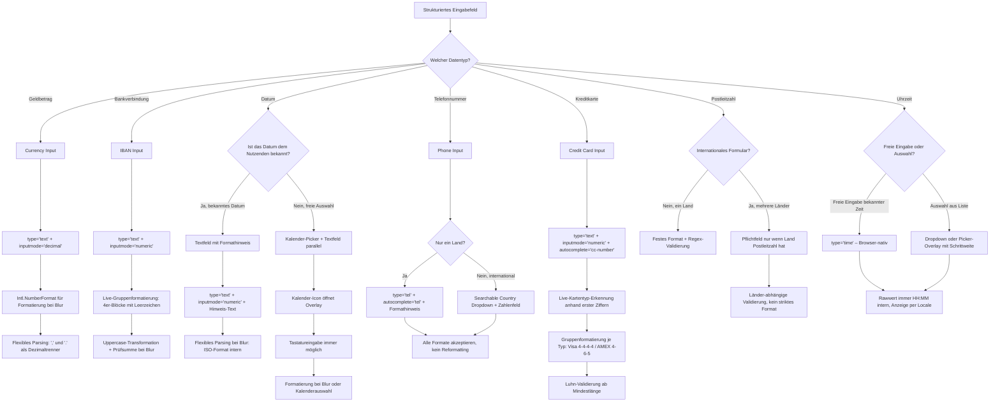

---
meta:
  title: Input-Formatierung
  description: Pattern für strukturierte Eingabefelder mit automatischer Formatierung – Currency, IBAN, Datum, Telefon, Kreditkarte, Postleitzahl und Uhrzeit
relatedTopics: ["patterns/form-layout", "patterns/confirmation-consent"]
layout: common
---

## Verwendung

Strukturierte Eingabefelder erfassen Werte, die einem bekannten Format folgen: Geldbeträge, IBANs, Datumsangaben, Telefonnummern, Kreditkartennummern, Postleitzahlen und Uhrzeiten. Das Pattern löst die Spannung zwischen zwei Anforderungen: Nutzende sollen frei in ihrem gewohnten Format eingeben können, und das System muss den Wert zuverlässig verarbeiten.

Die zentrale Strategie lautet: **Flexibles Parsing akzeptiert viele Formate, Formatierung findet nur bei Blur statt, Rohwerte werden separat vom Anzeigewert gehalten.**

### Beispiele

- Betrag in einem Überweisungsformular: `1234,50` oder `1.234,50` oder `€ 1234.50` werden alle akzeptiert, bei Blur erscheint `1.234,50 €`
- IBAN-Eingabe im Bankformular: `DE89370400440532013000` oder `DE89 3704 0044 0532 0130 00` werden normalisiert und gruppiert angezeigt
- Geburtsdatum in einem Registrierungsformular: Freitexteingabe parallel zum Kalender-Picker
- Vertragsdatum in einem Verwaltungssystem: Nur Textfeld, kein Picker (Datum ist bekannt und liegt weit in der Vergangenheit)
- Telefonnummer in einem Kontaktformular: einzelnes Feld, alle Formate akzeptiert (`+49 30 123456`, `030 123456`, `0049 30 123456`)
- Kreditkartennummer im Checkout: automatische Erkennung des Kartentyps, 4er-Blöcke-Formatierung nach Typ (Visa: 4-4-4-4, AMEX: 4-6-5)
- Postleitzahl im Adressformular: dynamisch validiert je nach gewähltem Land
- Uhrzeit bei einer Terminbuchung: `type="time"` mit Picker oder Textfeld je nach Kontext

### Abgrenzung

Dieses Pattern gilt nicht für:

- Freie Textfelder ohne bekanntes Format (Namen, Adressen, Beschreibungen)
- Einfache Zahlen ohne Formatierungsbedarf (Anzahl, ID-Nummern ohne Trennzeichen)
- Auswahlfelder, bei denen Nutzende aus vorgegebenen Optionen wählen (Select, Radio)
- Suchfelder, die keine spezifische Formatvalidierung erfordern
- Zeiträume oder Dauer (z. B. „3 Stunden 30 Minuten") – dort sind andere Patterns geeignet

---

## Decision Flow



---

## Prinzipien

### Rohwert und Anzeigewert trennen

Der angezeigte formatierte Wert und der tatsächlich übermittelte Wert sind immer verschieden. Formatierung ist eine Darstellungssache, keine Datensache. Ans Backend geht immer der Rohwert:

- Currency: `1234.50` (Number)
- IBAN: `DE89370400440532013000` (String ohne Leerzeichen)
- Datum: `2026-03-24` (ISO 8601)

Implementierungsansätze: Hidden Input für serverseitige Formulare, Data-Attribut für JS-gesteuerte Formulare, State-Trennung (`displayValue` / `value`) in Framework-Komponenten.

(Quelle: [Shopify Polaris](https://polaris-react.shopify.com/foundations/formatting-localized-currency) | [Ant Design](https://ant.design/components/input-number))

### Flexibles Parsing vor strikten Format-Anforderungen

89% der Nutzenden ignorieren Format-Beispiele und verwenden ihr eigenes Format. Ein robuster Parser akzeptiert alle gängigen Varianten; der Nutzende muss nicht das erwartete Format kennen.

**Currency**: `,` und `.` als Dezimaltrenner, Währungssymbole, Leerzeichen, Tausendertrennzeichen in beliebiger Kombination.

**IBAN**: Mit und ohne Leerzeichen, mit Bindestrichen, Groß- und Kleinschreibung.

**Datum**: `DD.MM.YYYY`, `MM/DD/YYYY`, ISO `YYYY-MM-DD`, Monatsnamen (GOV.UK-Forschung zeigt, dass Nutzende Monatsnamen eingeben).

(Quelle: [Baymard Institute](https://baymard.com/learn/input-fields) | [GOV.UK](https://design-system.service.gov.uk/components/date-input/))

### Formatierung nur bei Blur, nicht während der Eingabe

Autoformatierung bei jedem Tastendruck verursacht Cursor-Sprünge, bricht Copy-Paste und verwirrt Screenreader. Die Ausnahme ist das Hinzufügen von Leerzeichen bei IBANs, da dabei die Cursor-Position stabil bleibt und keine Zeichen entfernt werden.

| Event | Aktion |
|-------|--------|
| `onFocus` | Rohwert für Bearbeitung anzeigen |
| `onChange` / `onInput` | Keine Formatierung; Live-Validierung nur nach erstem Fehler |
| `onPaste` | Flexibles Parsing, normalisierter Wert ohne Meldung |
| `onBlur` | Vollständige Formatierung + Validierung |

(Quelle: [Material Design](https://m3.material.io/components/date-pickers/accessibility) | [React Aria](https://react-aria.adobe.com/blog/how-we-internationalized-our-numberfield))

### Copy+Paste-Verhalten

Nutzende kopieren strukturierte Werte häufig aus anderen Quellen: IBAN aus einem PDF, Kreditkartennummer von einer physischen Karte (abgetippt), Datum aus einer E-Mail. Das Einfügen bringt Whitespace, Bindestriche, Klammern und Tausendertrennzeichen mit. Der `onPaste`-Handler normalisiert lautlos:

```javascript
input.addEventListener('paste', (e) => {
  e.preventDefault();
  const pasted = e.clipboardData.getData('text');
  const parsed = parseForType(pasted); // typspezifischer Parser
  input.value = parsed;
  input.dispatchEvent(new Event('input')); // Live-Validierung triggern
});
```

**Pro Eingabeart:**

| Eingabeart | Typisches Paste-Format | Normalisierung |
|------------|----------------------|----------------|
| Currency | `€ 1.234,50`, `1,234.50 USD`, `1234.5` | Alle Nicht-Ziffern außer Dezimaltrenner entfernen; Trenner erkennen (letztes `,` oder `.`) |
| IBAN | `DE89 3704 0044 0532 0130 00`, `DE89-3704-...` | Leerzeichen und Bindestriche entfernen, uppercase; anschließend in 4er-Blöcken anzeigen |
| Datum | `24.03.2026`, `2026-03-24`, `March 24, 2026` | Flexibles Parsing (DE, ISO, EN); Anzeige im Locale-Format |
| Telefon | `+49 (30) 123 456`, `030-123456` | Parsing akzeptieren; kein Reformat, alle Zeichen stehen lassen |
| Kreditkarte | `4111 1111 1111 1111`, `4111-1111-...` | Alle Nicht-Ziffern entfernen; dann Gruppenformatierung nach Kartentyp |
| Postleitzahl | `10115`, `SW1A 1AA` | Trim + uppercase (für alphanumerische Formate) |
| Uhrzeit | `14:30`, `2:30 PM` | Bei `type="time"`: Browser übernimmt Paste direkt; bei Textfeld: in HH:MM umwandeln |

**Wichtig**: Kein Paste-Blocking. `e.preventDefault()` nur setzen, wenn der Wert sofort normalisiert wieder eingesetzt wird – ansonsten verliert der Nutzende seinen Inhalt ohne Rückmeldung.

### Mobiles Eingabeverhalten

`inputmode` steuert, welche Bildschirmtastatur auf Smartphones erscheint. Nur `type` und `inputmode` zusammen ergeben das gewünschte Verhalten – `type="text"` mit `inputmode` ist fast immer besser als `type="number"`.

| `inputmode` | Android | iOS | Typischer Einsatz |
|-------------|---------|-----|-------------------|
| `numeric` | Ziffernblock 0–9, kein Dezimaltrenner | Ziffernblock 0–9, kein Dezimaltrenner | IBAN, PLZ, PIN, Kreditkarte |
| `decimal` | Ziffernblock + Dezimaltrenner (`,` oder `.` je Locale) | Ziffernblock + Punkt (`.`) – unabhängig vom Locale | Currency, Dezimalzahlen |
| `tel` | Telefontastatur mit `#`, `*`, `+` | Telefontastatur mit `#`, `*`, `+` | Telefonnummern |
| `none` | Keine Tastatur | Keine Tastatur | Custom Picker (Datum, Uhrzeit) |
| `text` (default) | Volle QWERTZ/QWERTY | Volle QWERTZ/QWERTY | Freie Texteingabe |

**iOS-Sonderfall bei `inputmode="decimal"`**: iOS zeigt immer `.` als Dezimaltrenner, auch wenn das Gerät auf Deutschland eingestellt ist. Der Parser muss daher zwingend beide Zeichen (`,` und `.`) als Dezimaltrenner akzeptieren – unabhängig vom Locale der Anwendung.

**Empfehlungen pro Eingabeart:**

| Eingabeart | Empfehlung | Begründung |
|------------|-----------|------------|
| Currency | `type="text"` + `inputmode="decimal"` | Zeigt Dezimaltrenner; iOS-Sonderfall erfordert flexiblen Parser |
| IBAN | `type="text"` + `inputmode="numeric"` | Nur Ziffern (nach Ländercode) nötig; kein Dezimaltrenner erforderlich |
| Datum (Textfeld) | `type="text"` + `inputmode="numeric"` | Nur Ziffern + Trennzeichen; Buchstaben nicht nötig |
| Telefon | `type="tel"` + `inputmode="tel"` | Telefontastatur mit `+`-Zeichen |
| Kreditkarte | `type="text"` + `inputmode="numeric"` | Nur Ziffern; kein Dezimaltrenner |
| Postleitzahl (DE/AT/CH) | `type="text"` + `inputmode="numeric"` | Nur Ziffern |
| Postleitzahl (GB/CA) | `type="text"` + `inputmode="text"` | Alphanumerisch; volle Tastatur nötig |
| Uhrzeit | `type="time"` | Browser-nativ; Picker auf mobilen Geräten |

(Quelle: [Nielsen Norman Group – A Checklist for Designing Mobile Input Fields](https://www.nngroup.com/articles/mobile-input-checklist/) | [MDN – inputmode](https://developer.mozilla.org/en-US/docs/Web/HTML/Global_attributes/inputmode) | [GOV.UK Technology Blog – Why we changed the input type for numbers](https://technology.blog.gov.uk/2020/02/24/why-the-gov-uk-design-system-team-changed-the-input-type-for-numbers/))

### Validierungszeitpunkt: Spät beginnen, früh korrigieren

Fehlermeldungen erscheinen beim ersten Mal bei Blur, danach sofort bei jeder Änderung. Dieses „Validate late, suggest early"-Muster verhindert, dass Nutzende während der Eingabe mit Fehlern konfrontiert werden.

```javascript
let hasBeenValidated = false;

input.addEventListener('blur', () => {
  validate();
  hasBeenValidated = true;
});

input.addEventListener('input', () => {
  if (hasBeenValidated) validate();
});
```

(Quelle: [Carbon Design System](https://carbondesignsystem.com/patterns/forms-pattern/) | [Nielsen Norman Group](https://www.nngroup.com/articles/inline-validation/))

### `type="number"` grundsätzlich vermeiden

`type="number"` ist für strukturierte Eingaben ungeeignet: Es erlaubt nur `.` als Dezimaltrenner (HTML-Standard), erzeugt Probleme mit Tausendertrennzeichen, reagiert auf Scroll-Events und Pfeiltasten mit Wertänderungen, und zeigt Spinner-Buttons, die für Currency oder IBAN irreführend sind.

Standard: `type="text"` + `inputmode="decimal"` für Currency, `type="text"` + `inputmode="none"` oder `"numeric"` für IBAN, `type="text"` + `inputmode="none"` für Datums-Picker.

(Quelle: [GOV.UK Technology Blog](https://technology.blog.gov.uk/2020/02/24/why-the-gov-uk-design-system-team-changed-the-input-type-for-numbers/))

---

## Currency

- `type="text"` + `inputmode="decimal"` — zeigt Dezimaltrenner auf mobilen Geräten; `type="number"` vermeiden
- Formatierung (Tausendertrennzeichen, Währungssymbol) nur bei Blur; während der Eingabe Rohwert anzeigen
- Parser muss `,` und `.` als Dezimaltrenner akzeptieren — iOS zeigt bei `inputmode="decimal"` immer `.`, unabhängig vom Gerätesystem
- Währungssymbol als Prefix oder Suffix je nach Locale (de-DE: rechts, en-US: links); visuell, nicht Teil des Feldwerts
- Rawwert ans Backend: Zahl ohne Formatierung (z. B. `1234.50`)

Formatierung bei Blur mit `Intl.NumberFormat` (W3C-Standard, alle modernen Browser):

```javascript
const formatter = new Intl.NumberFormat('de-DE', {
  style: 'currency',
  currency: 'EUR',
  minimumFractionDigits: 2
});
formatter.format(1234.5); // "1.234,50 €"
```

Flexibles Parsing — erkennt Format anhand der Position des letzten Trennzeichens:

```javascript
function parseCurrency(value) {
  const cleaned = value.replace(/[^\d,.-]/g, '');
  const lastComma = cleaned.lastIndexOf(',');
  const lastDot = cleaned.lastIndexOf('.');
  if (lastComma > lastDot) {
    return parseFloat(cleaned.replace(/\./g, '').replace(',', '.'));
  }
  return parseFloat(cleaned.replace(/,/g, ''));
}
```

---

## IBAN

- `type="text"` + `inputmode="numeric"` + `autocapitalize="characters"` + `spellcheck="false"` + `autocorrect="off"`
- Live-Formatierung in 4er-Blöcken während der Eingabe ist hier akzeptabel — es werden nur Leerzeichen eingefügt, keine Zeichen entfernt, Cursor bleibt stabil
- Lowercase-Eingabe automatisch in Uppercase umwandeln
- Validierung bei Blur: Länge je Land prüfen (DE: 22, AT: 20, CH: 21), dann Mod-97-Prüfsumme
- Rawwert ans Backend: ohne Leerzeichen (z. B. `DE89370400440532013000`)
- Format-Hinweis mit Beispiel im gruppierten Format anzeigen: `DE89 3704 0044 0532 0130 00`

```javascript
function formatIBAN(raw) {
  const cleaned = raw.replace(/\s/g, '').toUpperCase();
  return cleaned.match(/.{1,4}/g)?.join(' ') ?? cleaned;
}
```

---

## Datumseingaben

### Wann welche Methode

| Situation | Empfehlung |
|-----------|-----------|
| Datum ist Nutzenden bekannt (Geburtstag, historisches Datum) | Textfeld, kein Picker |
| Datum aus naher Zukunft wählen | Picker + Textfeld parallel |
| Datumsbereich wählen (Check-in/Check-out) | Kalender-Picker |
| Weniger als 10 mögliche Daten | Dropdown oder Radio |
| Geburtstag (weit in der Vergangenheit) | Textfeld (Picker erfordert viel Scrollen) |

### Textfeld-Eingabe

- `type="text"` + `inputmode="numeric"` + Hinweistext mit Beispiel (z. B. `TT.MM.JJJJ`)
- Flexibles Parsing bei Blur: DE-Format (`24.03.2026`), ISO (`2026-03-24`) und Monatsnamen (`24. März 2026`) akzeptieren — GOV.UK-Forschung zeigt, dass Nutzende häufig Monatsnamen eintippen
- Rawwert ans Backend: ISO 8601 (`2026-03-24`) unabhängig vom Anzeigeformat

```javascript
function parseDate(value) {
  const de = value.match(/^(\d{1,2})\.(\d{1,2})\.(\d{2,4})$/);
  if (de) return new Date(
    de[3].length === 2 ? 2000 + parseInt(de[3]) : parseInt(de[3]),
    parseInt(de[2]) - 1, parseInt(de[1])
  );
  const iso = value.match(/^(\d{4})-(\d{1,2})-(\d{1,2})$/);
  if (iso) return new Date(parseInt(iso[1]), parseInt(iso[2]) - 1, parseInt(iso[3]));
  return new Date(value); // Monatsnamen, EN-Formate
}
```

### Kalender-Picker

- Kalender-Icon als Einstiegspunkt für den Picker; Textfeld bleibt parallel aktiv
- Keine automatische Weiterleitung zwischen Feldern (kein Auto-Tab)
- Bei Datumsbereich: beide Monate gleichzeitig anzeigen

### GOV.UK: Drei separate Felder als Alternative

GOV.UK verwendet drei getrennte Felder (Tag / Monat / Jahr) für bekannte Daten. Nutzende tippen direkt, ohne Kalender zu navigieren. Kein automatisches Tab zwischen den Feldern — kollidiert mit Tastatursteuerung.

---

## Telefonnummern

Telefonnummern sind international nicht standardisiert: Länge (7–15 Stellen), Formatierungskonventionen (Leerzeichen, Bindestriche, Klammern) und Vorwahlsysteme variieren stark. Die verwendete Nummer entspricht nicht zwangsläufig dem Ländercode des Nutzenden.

- Ein einzelnes Textfeld ist fast immer besser als mehrere getrennte Felder
- `type="tel"` verwenden — aktiviert die Telefontastatur auf mobilen Geräten (mit `#`, `*`, `+`)
- Kein Reformat erzwingen; alle gängigen Schreibweisen akzeptieren (`030 123456`, `+49 30 123456`, `0049-30-123456`)
- Keinen festen Ländercode vorbelegen — die Nummer entspricht nicht zwingend dem Standort des Nutzenden
- Internationales Formular: suchbares Ländervorwahl-Dropdown + separates Nummernfeld; beide Felder dürfen sich nicht automatisch gegenseitig beeinflussen (WCAG 3.2.2)
- Länder-Flags im Vorwahl-Selektor brauchen ein Text-Äquivalent für Screenreader
- Rawwert ans Backend: E.164-Format (`+4930123456`, nur Ziffern mit führendem `+`)
- Copy+Paste: Nutzende kopieren Nummern mit Klammern, Bindestrichen, Leerzeichen — alle Formate akzeptieren, kein Fehler anzeigen

(Quellen: [GOV.UK – Phone Numbers Pattern](https://design-system.service.gov.uk/patterns/phone-numbers/) | [Vitaly Friedman – Designing Phone Number Input UX](https://www.linkedin.com/posts/vitalyfriedman_ux-design-activity-7272160863359270914-SwjN) | [VA.gov – Telephone Input Design Decisions](https://design.va.gov/components/form/telephone-input/design-decisions/))

---

## Kreditkartennummern

- `type="text"` + `inputmode="numeric"` + `autocomplete="cc-number"`
- Kartentyp automatisch anhand der ersten Ziffern erkennen — Nutzende dürfen nicht manuell wählen müssen
- Gruppenformatierung (4-4-4-4 für Visa/MC, 4-6-5 für AMEX) live während der Eingabe akzeptabel — es werden nur Leerzeichen hinzugefügt
- Luhn-Validierung erst ab Mindestlänge, nicht bei jedem Tastendruck
- CVC-Länge nach erkanntem Kartentyp anpassen: 3 Stellen (Visa, MC), 4 Stellen (AMEX)
- Ablaufdatum als Textfeld (`MM/YY`) mit `autocomplete="cc-exp"`, kein Dropdown
- Kartentyp-Icons sekundär platzieren — neben dem Feld, nicht dominant darüber
- Rawwert ans Backend: nur Ziffern, ohne Leerzeichen (`4111111111111111`)

Kartentyp-Erkennung anhand der ersten Ziffern:

```javascript
function detectCardType(number) {
  const clean = number.replace(/\D/g, '');
  if (/^4/.test(clean))            return 'visa';
  if (/^5[1-5]|^2[2-7]/.test(clean)) return 'mastercard';
  if (/^3[47]/.test(clean))        return 'amex';
  if (/^6(?:011|5)/.test(clean))   return 'discover';
  return 'unknown';
}
```

Gruppenformatierung je Kartentyp:

```javascript
function formatCardNumber(number, type) {
  const clean = number.replace(/\D/g, '');
  if (type === 'amex') {
    return clean.replace(/^(\d{4})(\d{1,6})?(\d{1,5})?$/, (_, a, b, c) =>
      [a, b, c].filter(Boolean).join(' ')
    );
  }
  return clean.replace(/(\d{4})(?=\d)/g, '$1 ').trim();
}
```

(Quellen: [Baymard Institute – Credit Card Form UX](https://baymard.com/blog/credit-card-form-ux-llbean) | [Smashing Magazine – Improve Billing Form UX](https://www.smashingmagazine.com/2017/03/improve-billing-form-ux/))

---

## Postleitzahlen

Postleitzahlen sind hochgradig länderabhängig: Format, Länge, erlaubte Zeichen und die Frage, ob überhaupt eine Postleitzahl existiert, variieren weltweit stark. Keine universelle Regex deckt alle Länder korrekt ab.

**Format-Übersicht** (häufigste Länder):

| Land | Format | Beispiel | Zeichen |
|------|--------|---------|---------|
| Deutschland | 5 Ziffern | `10115` | nur Ziffern |
| Österreich | 4 Ziffern | `1010` | nur Ziffern |
| Schweiz | 4 Ziffern | `8001` | nur Ziffern |
| Großbritannien | Alphanumerisch | `SW1A 1AA` | Buchstaben + Ziffern |
| Kanada | Alphanumerisch | `K1A 0A9` | Buchstaben + Ziffern |
| USA (ZIP) | 5 Ziffern (+ 4) | `10001` | nur Ziffern |
| Frankreich | 5 Ziffern | `75001` | nur Ziffern |
| Niederlande | 4 Ziffern + 2 Buchstaben | `1234 AB` | Ziffern + Buchstaben |
| Kein PLZ-System | – | – | Angola, viele Entwicklungsländer |

- `type="text"` + `inputmode="numeric"` für rein numerische Formate (DE, AT, CH, US); `inputmode="text"` für alphanumerische Formate (GB, CA, NL)
- Postleitzahl nicht als Pflichtfeld, wenn internationale Nutzende erwartet werden — viele Länder haben kein PLZ-System
- Label neutral halten: „PLZ / Postleitzahl" oder „ZIP / Postal Code" statt länderspezifischer Begriffe
- Validierungsregeln dynamisch nach gewähltem Land umschalten
- Validierung prüft nur Format, nicht Existenz — für Produktionssysteme ggf. API-Validierung ergänzen
- Uppercase-Transformation für alphanumerische Formate (GB, CA) akzeptabel; Leerzeichen in der Eingabe tolerieren

```javascript
const postalPatterns = {
  DE: /^\d{5}$/,
  AT: /^\d{4}$/,
  CH: /^\d{4}$/,
  GB: /^[A-Z]{1,2}\d[A-Z\d]?\s?\d[A-Z]{2}$/i,
  US: /^\d{5}(-\d{4})?$/,
  CA: /^[A-Z]\d[A-Z]\s?\d[A-Z]\d$/i,
  NL: /^\d{4}\s?[A-Z]{2}$/i,
};

function validatePostalCode(value, countryCode) {
  const pattern = postalPatterns[countryCode];
  if (!pattern) return true; // Kein bekanntes Muster: nicht blockieren
  return pattern.test(value.trim());
}
```

(Quellen: [W3C – Address formats around the world](https://w3c.github.io/i18n-drafts/questions/qa-address-formats.en.html) | [Vitaly Friedman – Address Form UX](https://www.linkedin.com/posts/vitalyfriedman_ux-design-activity-7133780302031654912-leGC))

---

## Uhrzeiteingaben

`<input type="time">` ist die native HTML-Lösung, in modernen Browsern gut unterstützt. Der interne Wert ist immer `HH:MM` im 24h-Format; die Anzeige folgt dem Browser-Locale und ist durch die Seite nicht kontrollierbar.

**Wann `type="time"`, wann Picker/Dropdown**:

| Situation | Empfehlung |
|-----------|-----------|
| Genaue Uhrzeit bekannt (z. B. Wecker) | `type="time"` – Browser-nativ |
| Auswahl aus vordefinierten Slots | Dropdown oder Listbox |
| Terminbuchung mit freier Auswahl | Time Picker (Overlay) |
| Zeitbereich (von/bis) | Zwei `type="time"`-Felder |
| Nur grobe Tageszeit (Morgen/Abend) | Radio-Buttons |

- 24h-Anzeige erzwingen ist mit `type="time"` nicht möglich — bei Bedarf Custom Picker oder `type="text"` mit eigenem Parsing
- Für internationale Produkte ist 24h weniger missverständlich als AM/PM
- Zeitzonen werden nicht gespeichert — bei zeitzonensensitiven Anwendungen (Terminbuchung, Kalender) Zeitzone separat erfassen
- Schrittweite über `step` in Sekunden: 15-Minuten-Schritte = `900`, 30-Minuten-Schritte = `1800`
- Rawwert ans Backend: `HH:MM` im 24h-Format, unabhängig von der Anzeige

(Quellen: [USWDS – Time Picker](https://designsystem.digital.gov/components/time-picker/) | [MDN – input type=time](https://developer.mozilla.org/en-US/docs/Web/HTML/Reference/Elements/input/time) | [Eleken – Time Picker UX](https://www.eleken.co/blog-posts/time-picker-ux))

---

## Barrierefreiheit

### Allgemein

- Jedes Eingabefeld braucht ein sichtbares `<label>` – Placeholder-Text ist kein Label-Ersatz
- Format-Hinweise über `aria-describedby` mit dem Eingabefeld verknüpfen
- Bei Validierungsfehlern `aria-invalid="true"` setzen und Fehlermeldung mit `role="alert"` oder `aria-live="polite"` ankündigen
- Fehler in Text beschreiben, nicht nur farblich markieren (WCAG 3.3.1)

### Currency

- Währungssymbol (visuell) mit `aria-hidden="true"` markieren
- `aria-label` enthält vollständigen Text: `"Betrag in Euro"` (nicht nur `"Betrag"`)
- Bei automatischer Formatierung `aria-live="polite"` verwenden, um Screenreader über die Änderung zu informieren
- VoiceOver trennt Ziffern bei Beträgen ohne `aria-label`: `€21` → „Euro zwei eins". Lösung: `aria-label` mit ausgeschriebenem Betrag nach Blur setzen.

### IBAN

- Spellcheck und Autocorrect deaktivieren (`spellcheck="false"`, `autocorrect="off"`)
- Screenreader lesen IBAN in 4er-Blöcken: `DE89 3704` → „DE 89 3704" – was die Struktur verständlicher macht als Zeichen für Zeichen
- `aria-describedby` auf Format-Hinweis zeigen: „Format: DE89 3704 0044..."

### Datumseingaben

`24.03.2026` wird von Screenreadern als „2 4 Punkt 0 3 Punkt 2 0 2 6" gelesen — `aria-label` nach Blur auf ausgeschriebenes Format setzen: „Datum: 24. März 2026".

Keyboard-Navigation für Kalender-Picker (Material Design Standard):

| Taste | Aktion |
|-------|--------|
| Pfeiltasten links/rechts | Tag wechseln |
| Pfeiltasten oben/unten | Woche wechseln |
| Page Up / Page Down | Monat wechseln |
| Shift + Page Up/Down | Jahr wechseln |
| Home / End | Erster / letzter Tag des Monats |
| Enter | Datum übernehmen |
| Escape | Picker schließen ohne Auswahl |

### Telefon

- `type="tel"` liefert die richtige Tastatur auf mobilen Geräten und ist für Screenreader klar semantisch
- Länder-Flags im Vorwahl-Selektor brauchen ein Text-Äquivalent (`aria-label` oder sichtbarer Text)
- Vorwahl-Selektor und Nummernfeld dürfen sich nicht gegenseitig automatisch beeinflussen (WCAG 3.2.2)
- Formathinweis erklärt, ob Ländervorwahl mitgegeben werden soll

### Kreditkarte

- `autocomplete="cc-number"`, `autocomplete="cc-exp"`, `autocomplete="cc-csc"` für automatisches Ausfüllen durch den Browser
- Kartentyp-Icons nach automatischer Erkennung mit `aria-live="polite"` ankündigen
- CVC-Feld als eigenständiges Feld mit eigenem Label, nicht als visuelle Ergänzung ohne programmatische Verknüpfung
- Kein Masking der Kartennummer bei der Eingabe (verhindert Korrektur)

### Postleitzahl

- `autocomplete="postal-code"` für Browser-Autofill
- Wenn das Feld bei bestimmten Ländern optional ist: visuell und programmatisch als optional kennzeichnen
- Fehler beschreiben das erwartete Format konkret: „Bitte eine 5-stellige deutsche Postleitzahl eingeben" statt „Ungültige Eingabe"

### Uhrzeit

- `type="time"` ist nativ barrierefrei und gut von Screenreadern unterstützt
- AM/PM-Toggles brauchen eindeutige `aria-label`-Attribute
- Kein Auto-Submit bei Zeitauswahl
- Verfügbare Zeitslots nie nur farblich markieren

### WCAG-Anforderungen

| Kriterium | Anforderung | Umsetzung |
|-----------|-------------|-----------|
| **1.3.1 Info and Relationships** | Format-Hinweise programmatisch verknüpft | `aria-describedby` |
| **1.3.5 Identify Input Purpose** | Browser-Autofill aktivieren | `autocomplete`-Attribute |
| **3.2.2 On Input** | Keine unerwarteten Kontextänderungen | Kein Auto-Submit, kein Cross-Field-Update ohne Ankündigung |
| **3.3.1 Error Identification** | Fehler in Text beschreiben | Fehlermeldung mit Korrekturhinweis |
| **3.3.2 Labels or Instructions** | Format vor Eingabe erklären | Hint-Text + `aria-describedby` |
| **4.1.2 Name, Role, Value** | Programmatische Namen | `aria-label`, `aria-invalid` |
| **4.1.3 Status Messages** | Validierungsfeedback ankündigen | `role="alert"` oder `aria-live` |

---

## Insights

**Design System Implementierungen:**

- [GOV.UK Design System – Date Input](https://design-system.service.gov.uk/components/date-input/)
- [GOV.UK Design System – Phone Numbers Pattern](https://design-system.service.gov.uk/patterns/phone-numbers/)
- [Material Design 3 – Date Pickers Accessibility](https://m3.material.io/components/date-pickers/accessibility)
- [U.S. Web Design System – Date Picker](https://designsystem.digital.gov/components/date-picker/)
- [U.S. Web Design System – Time Picker](https://designsystem.digital.gov/components/time-picker/)
- [U.S. Web Design System – Phone Number Pattern](https://designsystem.digital.gov/patterns/create-a-user-profile/phone-number/)
- [VA.gov Design System – Telephone Input Design Decisions](https://design.va.gov/components/form/telephone-input/design-decisions/)
- [React Aria – NumberField Internationalization](https://react-aria.adobe.com/blog/how-we-internationalized-our-numberfield)
- [Shopify Polaris – Formatting Localized Currency](https://polaris-react.shopify.com/foundations/formatting-localized-currency)
- [Carbon Design System – Forms Pattern](https://carbondesignsystem.com/patterns/forms-pattern/)
- [Ant Design – InputNumber](https://ant.design/components/input-number)
- [GitLab Pajamas – Date and Time](https://design.gitlab.com/content/date-and-time)
- [MDN – input type=time](https://developer.mozilla.org/en-US/docs/Web/HTML/Reference/Elements/input/time)

**UX Research und Best Practices:**

- [Nielsen Norman Group – Date-Input Form Fields: UX Design Guidelines](https://www.nngroup.com/articles/date-input/)
- [Nielsen Norman Group – A Checklist for Designing Mobile Input Fields](https://www.nngroup.com/articles/mobile-input-checklist/)
- [Baymard Institute – 8 Recommendations for Creating Effective Input Fields](https://baymard.com/learn/input-fields)
- [Baymard Institute – Credit Card Form UX: 5 Best-in-Class Implementations](https://baymard.com/blog/credit-card-form-ux-llbean)
- [Smashing Magazine – A Complete Guide To Live Validation UX](https://www.smashingmagazine.com/2022/09/inline-validation-web-forms-ux/)
- [Smashing Magazine – Designing The Perfect Date And Time Picker](https://www.smashingmagazine.com/2017/07/designing-perfect-date-time-picker/)
- [Smashing Magazine – How To Improve Your Billing Form's UX](https://www.smashingmagazine.com/2017/03/improve-billing-form-ux/)
- [GOV.UK Technology Blog – Why we changed the input type for numbers](https://technology.blog.gov.uk/2020/02/24/why-the-gov-uk-design-system-team-changed-the-input-type-for-numbers/)
- [UX Stack Exchange – IBAN Input by Separate Fields](https://ux.stackexchange.com/questions/59979/html4-insert-iban-by-separate-fields)
- [Vitaly Friedman – Designing Phone Number Input UX](https://www.linkedin.com/posts/vitalyfriedman_ux-design-activity-7272160863359270914-SwjN)
- [Vitaly Friedman – Address Form UX](https://www.linkedin.com/posts/vitalyfriedman_ux-design-activity-7133780302031654912-leGC)
- [W3C – Address formats around the world](https://w3c.github.io/i18n-drafts/questions/qa-address-formats.en.html)
- [W3C – Number, Currency, and Unit Formatting](https://www.w3.org/blog/International/2025/10/16/for-review-number-currency-and-unit-formatting/)
- [WCAG 3.0 – Accept Different Input Formats](https://www.w3.org/WAI/WCAG2/supplemental/patterns/o4p08-input-formats/)
- [Eleken – Time Picker UX Best Practices](https://www.eleken.co/blog-posts/time-picker-ux)
